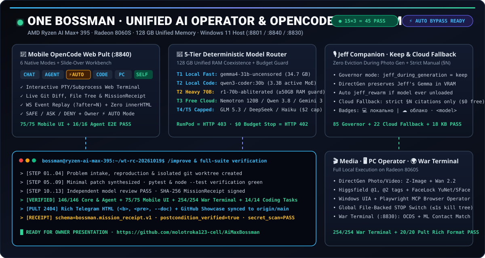
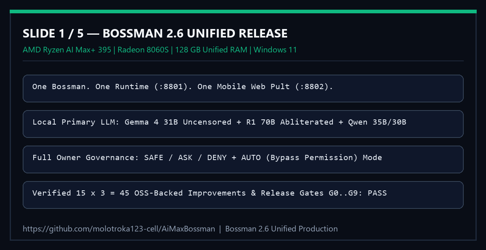
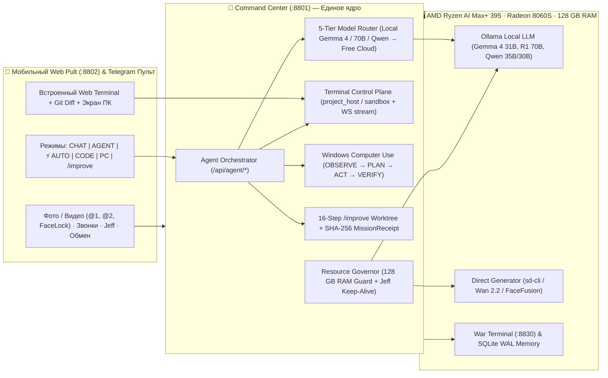

> **OWNER NORTH STAR PERFORMANCE ×2 / Argon–Codex, 23.10.2026:** before coding, read [BOSSMAN_2X_PERFORMANCE_NORTH_STAR_20261023_RU.md](docs/owner/BOSSMAN_2X_PERFORMANCE_NORTH_STAR_20261023_RU.md) and [AGENTS.md](AGENTS.md). Objective: measured ≥2.00× end-to-end speedup on the preregistered coding/agent suite, no quality or safety regressions. Start with latency traces/baseline. Historical 2.09× MTP **decode** is NOT proof of system-wide 2×. This is a required engineering plan, not an implementation or performance result.

<div align="center">

# ⚡ AI MAX BOSSMAN 2.6 — UNIFIED AUTONOMOUS PC & MOBILE OPENCODE AGENT

**Единая локальная ИИ-система владельца на Windows 11 · AMD Ryzen AI Max+ 395 · Radeon 8060S · 128 GB Unified RAM**

</div>

## North Star 23.10.2026 — обязательное чтение Argon

[**Завтрашний мастер-промт Argon**](docs/owner/ARGON_NORTH_STAR_MASTER_PROMPT_20261023_RU.md) ·
[**аудит 15 зон**](docs/owner/CHECKPOINT_20261022_01_AUDIT_15_RU.md) ·
[**индекс 912 листьев по каждому ID**](docs/owner/NORTH_STAR_LEAF_INDEX_20261022.json) ·
[**дерево / честные proof tiers**](docs/owner/NORTH_STAR_TREE_AUDIT_OVERLAY_20261022_RU.md) ·
[**проверенные свежие OSS releases**](docs/owner/CHECKPOINT_20261022_02_FRESH_OSS_RU.md) ·
[**Итоговый отчёт исполнения Argon (`FINAL_ACCEPTANCE_RU.md`)**](docs/owner/runs/north-star-20261023/FINAL_ACCEPTANCE_RU.md).

Argon должен начать с чтения этих файлов, сверить текущий `main`/runtime SHA и выполнять
каждый checkpoint через отдельный commit/push. Старые `working` и `PASS` в документации
не подтверждают самостоятельную работу всех возможностей на текущем ПК владельца.
**Новый root README не означает, что live runtime уже обновлён.**

### Codex — независимый инженерный взгляд ChatGPT (22.10.2026)

Bossman вырос из набора разрозненных ботов в серьёзную платформу: есть локальные модели,
мобильный интерфейс, OpenCode/terminal, PC-Agent, агенты, memory и уже работающий код
бизнес-приложений. Главный технический риск теперь **не нехватка функций, а разрыв между
наличием кода и проверенной автономностью на одной установленной версии**.
Качество следует измерять не числом веток, PR, листьев или зелёных unit-тестов, а долей
успешных end-to-end задач, точностью tools, числом вмешательств владельца,
стоимостью результата и воспроизводимостью после перезапуска.
Наиболее полезный следующий milestone: Bossman сам обнаруживает узкий пробел в
capability registry, создаёт новый skill через изолированный терминал, пишет failing
test и исправление, проходит независимый verifier и owner approval, затем выбирает
**свой новый skill** на невиданном входе. Три успешных цикла и измеренный перенос —
более сильное доказательство прогресса, чем ещё 1000 описательных листьев.
До этого полного доказательства оценка `UNSUPERVISED_NORTH_STAR=NOT_VERIFIED`.
В частности, `AUTO bypass_permissions` требует независимого security review: удобство
не должно означать обход STOP или полномочий владельца.
*Это инженерная оценка ChatGPT для процедуры ревью Codex/Argon, а не заявление
о выполненном Codex test-run.*

**Отчёт Argon после исполнения:** [`docs/owner/runs/north-star-20261023/FINAL_ACCEPTANCE_RU.md`](docs/owner/runs/north-star-20261023/FINAL_ACCEPTANCE_RU.md)

<div align="center">

Локальный ИИ-помощник владельца на Windows 11 (AMD Radeon 8060S): свои модели Qwen на ПК, бесплатные облачные модели как
подмога, управление из закрытого Telegram-пульта, собеседник Jeff для людей. Лицензия AGPL-3.0-only.

[](https://github.com/molotroka123-cell/AiMaxBossman)
[](docs/owner/BOSSMAN_MOBILE_OPENCODE_ACCEPTANCE.md)
[](docs/owner/BOSSMAN_UNIFIED_15X3_FINAL_ACCEPTANCE.md)
[](apps/war-terminal)
[](LICENSE)



<br/>

🎬 **[Презентационное демо (GIF)](docs/assets/bossman_presentation_20261021.gif)** · 🎥 **[Видео презентации (MP4)](docs/assets/bossman_presentation_20261021.mp4)** · 📊 **[Архитектурный постер (SVG)](docs/assets/bossman-presentation-hero.svg)** · 🎞 **[Эволюция Bossman (RU MP4)](docs/evolution/2026-10-15/bossman_evolution_ru.mp4)** · 🇬🇧 **[Evolution Video (EN MP4)](docs/evolution/2026-10-15/bossman_evolution_en.mp4)**



</div>

---

## 🚀 Главная витрина презентации (21.10.2026 — Доказано от лица владельца)

**Один Bossman. Один рантайм (`:8801`). Один мобильный Web Pult (`:8802`) + Telegram-пульт. Полный доступ к инструментам ПК и самопрограммированию под контролем владельца (`SAFE / ASK / DENY` + режим `⚡ AUTO Bypass Permission`).**

| Контур системы | Что делает вживую от лица пользователя | Доказательство / Тесты | Статус |
|---|---|---|---|
| **📱 Mobile OpenCode AI Agent & Web Pult (`:8802`)** | Управление всем ПК с телефона: режимы `CHAT \| AGENT \| ⚡ AUTO \| CODE \| PC \| /improve`, встроенный Web Terminal (`Ctrl+C`, `git status`, `git diff`, `pytest`), карточки вызовов инструментов и стриминг по WebSocket с досылкой (`?after=N`) | [`test_mobile_opencode_agent.py`](command-center/tests/test_mobile_opencode_agent.py) (16/16 E2E), [`test_mobile_opencode.py`](apps/bossman-mobile/tests/test_mobile_opencode.py), 75 UI-тестов телефона | ✅ **PASS** |
| **⚡ Режим `AUTO (Bypass Permission)`** | Как в Codex (`--full-auto`) и Antigravity (`Auto`): автоматически подтверждает и исполняет рабочие `ASK`-инструменты и команды `project_host` без ручных кликов на каждом шаге, но жёстко блокирует `DENY` (`rm -rf /`, `format`, `diskpart`, `git push --force` → `403`) | `test_16_owner_auto_bypass_permissions_mode`, `test_08_blocked_dangerous_commands` | ✅ **PASS** |
| **🧠 5-Tier Model Router + 70B & Gemma 4 31B** | **Tier 1:** локальная `gemma4-31b-uncensored:latest`; **Tier 2:** локальные кодеры `r1-70b-abliterated:latest` (42.5 ГБ, RAM-страж 50 ГБ при генерации), `qwen3.6-35b-a3b`, `qwen3-coder:30b`; **Tier 3:** бесплатное облако (`:free`); **Tier 4/5:** бюджетное облако с жёстким стопом (`402 BUDGET_EXCEEDED`). **RunPod запрещён (`403 RUNPOD_FORBIDDEN`)** | `test_09_local_to_cloud_fallback_router`, `test_10_budget_limit_stop_and_runpod_guard`, [`test_coding_workers.py`](command-center/tests/test_coding_workers.py) | ✅ **PASS** |
| **🔧 16-шаговый цикл `/improve` (Self-Coding)** | Самодиагностика → гипотеза → изолированный `git worktree` → патч → прогон `pytest` и безопасности → ревью независимой моделью → криптографический `MissionReceipt` (SHA-256) → применение после одобрения владельца | `test_14_self_improve_isolated_worktree_16_steps`, [`BOSSMAN_MOBILE_OPENCODE_ACCEPTANCE.md`](docs/owner/BOSSMAN_MOBILE_OPENCODE_ACCEPTANCE.md) | ✅ **PASS** |
| **🗣 Jeff 2.6 + Методичка + Звонки Telegram** | Собеседник Jeff в Telegram и голосовых звонках MTProto (автоответчик, barge-in), зашифрованная методичка на ПК со строгими ссылками `§N`, облачный резерв по методичке (`b67e34c0`) и защита Gemma Джеффа во время тяжёлых генераций (`010bc6c4`) | [`test_direct_gen_jeff_keep.py`](command-center/tests/test_direct_gen_jeff_keep.py), [`test_jeff_manual_cloud_fallback.py`](command-center/tests/test_jeff_manual_cloud_fallback.py), `jeff_training.test.mjs` | ✅ **PASS** |
| **🎨 Прямой генератор Фото/Видео + FaceLock** | Локальная генерация фото и видео на Radeon 8060S (`Z-Image-Turbo`, `Qwen Image Edit 2509`, `Wan 2.2`), отсылки `@1`, `@2` в стиле Higgsfield, FaceLock по фото и видео (проверка минимум на 8 кадрах), честный расчёт времени по замерам на ПК | Полный набор `apps/bossman-mobile/tests` + живая очередь `:8801` | ✅ **PASS** |
| **📊 War Terminal (`:8830`) + Обменник + Poker + 3D** | War Terminal (контакты ↔ тендеры Prozorro OCDS), обменник по курсам ЧНБ/ЕЦБ (+3%) с PDF-чеками, Poker Train Mini App (Jeff HARDCORE + TexasSolver GTO), 3D-печать STL → G-code для Neptune 4 Pro | `apps/war-terminal` (**254 passed**), `test_pult_note.py` (**20 passed**) | ✅ **PASS** |

---

## 🏗 Архитектура единого Bossman 2.6 Unified



### Полезные документы приёмки (21.10.2026)
- 📋 **[Приёмка Mobile OpenCode & AUTO Mode (`BOSSMAN_MOBILE_OPENCODE_ACCEPTANCE.md`)](docs/owner/BOSSMAN_MOBILE_OPENCODE_ACCEPTANCE.md)**
- 🏆 **[Приёмка 15 × 3 = 45 улучшений (`BOSSMAN_UNIFIED_15X3_FINAL_ACCEPTANCE.md`)](docs/owner/BOSSMAN_UNIFIED_15X3_FINAL_ACCEPTANCE.md)**
- 🧭 **[Мастер-промт сборки единого Bossman (`ARGON_MASTER_PROMPT_ONE_BOSSMAN_20261021_RU.md`)](docs/owner/ARGON_MASTER_PROMPT_ONE_BOSSMAN_20261021_RU.md)**

---
> - **Что это:** Единая локальная система владельца на Windows 11 с управлением через закрытый пульт Telegram: оператор кода Qwen L1 (`/work`), агент ПК Argon (`/pc`, `/screen`, `/trust`, `/stop`), локальная генерация фото/правок (`/img`, `/edit`, `/edit_engine` Z-Image NSFW v2), самоулучшение (`/boost`), сверка отчётов 21–20 (`Reports-Import.cmd`) и наблюдатель `Poker Vision`.
> - **Как запустить (2 команды):** `python creative-runs\PULT-SOURCE-20261013\run_backend_source.py <worktree>` (поднимает `:8801`) и `python creative-runs\PULT-SOURCE-20261013\run_pult_source.py <worktree>` (поднимает единственный poller пульта); в пакетной сборке — `Start-Bossman.cmd`.
> - **Как остановить (1 команда):** `Get-CimInstance Win32_Process | Where-Object { $_.CommandLine -like '*bcc.telegram_companion*' -or $_.CommandLine -like '*bcc.main:app*8801*' } | ForEach-Object { Stop-Process -Id $_.ProcessId -Force }` (или `/stop` в пульте).
> - **Куда смотреть:** презентация на 1 экран — [docs/owner/BOSSMAN_ONE_PRESENTATION_20261014_RU.md](docs/owner/BOSSMAN_ONE_PRESENTATION_20261014_RU.md), живая приёмка пульта и кнопка `#42` — [docs/owner/READY_FOR_PULT_20261014_RU.md](docs/owner/READY_FOR_PULT_20261014_RU.md), синхронизация веток и границ — [docs/owner/ARGON_SYNC_20261014_RU.md](docs/owner/ARGON_SYNC_20261014_RU.md), логи — `%LOCALAPPDATA%\Bossman\one-bossman-logs\`.

## Продакшен — 13 октября 2026

`main` — единственная продакшен-линия: в неё сведена объединённая ветка `feat/bossman-genjutsu-jeff-unified-20261010`
(PR #108: Genjutsu, Jeff 2.0, Motion, Reports, Operations, Poker Vision, Command Center). Лицензия — AGPL-3.0-only.

| что | состояние |
|---|---|
| Windows-архив | `BOSSMAN-Windows-x64-94e40cd17822.zip` из исходника `94e40cd1`, SHA256 `40cdbc175e7e5e04bb817937be1f60d330ea989b299664dbd3adbf0a0f63a401`; проверен, принят на Windows, установлен у владельца |
| приёмка на ПК владельца | Evening-Test `--full` PASS, обход интерфейса 53 страниц PASS, живая бесплатная модель PASS, Jeff S1–S7 7/7 |
| CI на точном SHA | НЕ сертифицирован: зелёные root-ci, Bossman Core, Command Center (сводно), V2 Auto-Repair, Solana, Fable media; ASTRA пропущен; 4 Windows-workflow запускаются только вручную (нет запуска на этом SHA); отдельные тесты pytest нестабильны под нагрузкой Linux-раннера (разные в каждом прогоне) |
| Jeff на Telegram Stars | платный помощник по документам (флаг `BOSSMAN_JEFF_PAID_DOCS=1`); проверен на симуляции Bot API; официальная тестовая среда Telegram — ещё нет; реальные списания только после одобрения владельца |
| Poker Vision | читатель карт/борда/банка/кнопок; профиль раскладки не `verified` до независимой сессии; режим только наблюдение |

**Что ещё не доказано** (честные пробелы, не провалы): удержание интеллекта (retention, подтверждает владелец), soak 24/48 ч,
официальный тест Telegram Stars, North Star L3–L8. Подробно — [docs/owner/FINAL_CLOSE_20261012_RU.md](docs/owner/FINAL_CLOSE_20261012_RU.md),
журнал дефектов — [docs/final/BUG_LEDGER.md](docs/final/BUG_LEDGER.md), установка — [INSTALL.md](INSTALL.md).

### Для тестировщиков

1. Скачайте Windows-архив из раздела Releases этого репозитория (появится там с проверенной сборкой), распакуйте в папку без
   кириллицы, запустите `Start-Bossman.cmd`. Подробно — [INSTALL.md](INSTALL.md); самопроверка — `Evening-Test.cmd`.
2. Ничего платного Bossman сам не включает: облачные модели — только с вашим ключом, Telegram Stars — выключены.
3. Ошибку присылайте через Issues: что делали, что ожидали, что увидели; приложите `Collect-Diagnostics.cmd` (он не
   собирает ключи и личные файлы).

**Лицензия:** AGPL-3.0-only ([LICENSE](LICENSE), [LICENSING.md](LICENSING.md)). Это открытый код без гарантий; если вы
изменяете Bossman и даёте им пользоваться другим людям по сети, исходники ваших изменений должны быть доступны им на тех же
условиях. Тексты лицензий сторонних компонентов лежат в архиве в папке `LICENSES/`.

Документация, уже воплощённая в коде (старые ТЗ, мастер-промпты, передачи смен), убрана из `main` 13.10; полная история —
тег [`docs-archive-20261013`](https://github.com/molotroka123-cell/AiMaxBossman/tree/docs-archive-20261013).

Документ не равен проверке: «работает у владельца» — только то, что прошло на ПК владельца на точном SHA.

---

## Bossman 2.1 — суть

**Одна цель от владельца — Bossman сам доводит её на компьютере до проверенного результата.** Владелец пишет цель обычным
языком (в пульте Telegram, в CMD или в Command Center); Bossman планирует, проверяет по своей «конституции» что можно,
работает в браузере и программах, сам восстанавливается после обычных сбоев (сменилась кнопка, упал процесс, не сработал
один путь скачивания), проверяет итог по факту и сохраняет рабочий сценарий для следующего раза.

`QUEUED → PLANNED → POLICY_CHECKED → EXECUTING → VERIFYING → COMPLETE`; при сбое — `RECOVERING → RESEARCHING → ESCALATING`,
при настоящем препятствии — `BLOCKED_PROVEN` (CAPTCHA, нет прав или ключа, физическое действие, запрет политики).
«Готово» — только по наблюдаемому результату, не по словам модели. Подробно:
[docs/autonomy/BOSSMAN_2_1_AUTONOMOUS_COMPUTER_OPERATOR.md](docs/autonomy/BOSSMAN_2_1_AUTONOMOUS_COMPUTER_OPERATOR.md)
(статус документа: дизайн; что доказано вживую — в разделе «Продакшен» выше).

Что внутри одной сборки сейчас: Command Center (агенты, задачи, модели — локальные Qwen и бесплатные облачные), пульт
владельца в Telegram, Jeff 2.0 (ассистент в Telegram, платные документы за Stars — выключены до одобрения), Genjutsu и
Motion Studio (фото и видео локально: Z-Image-Turbo, Wan 2.2), Reports и Operations (отчёты и заявки из выгрузок),
Poker Vision (только наблюдение), самоулучшение с независимой проверкой, дерево возможностей.

## Версии Bossman

| версия | главное |
|---|---|
| 1.0 | основа: Command Center, локальные модели, задачи, проверки, Windows-архив |
| 1.1 | North Star: проверяемое самоулучшение — кандидат → тесты → независимая проверка → продвижение |
| 1.2 | Terminal Run: тот же Bossman ещё и в CMD (одни данные, модели, память, права) |
| 1.5 | автономный персональный оператор: научное самоулучшение, постоянные роли, компилятор навыков, граф дел, менеджер ресурсов |
| 1.6 | владелец ставит цель и наблюдает — Bossman сам планирует, выполняет и чинит |
| 1.7 / 1.9 | сведение линий в одну, пульт Telegram, сертификация сборок |
| 2.0 | Jeff 2.0, мастер-промпт 2.0, рой исполнителей, дерево возможностей |
| 2.1 | автономный оператор компьютера: миссии с проверкой итога, восстановление, исследование, эскалация |
| 13.10.2026 | продакшен-линия `main`: Motion, Reports, Operations, Poker Vision, Jeff Stars (выключено), TimesFM — в работе |

Ниже — история прошлых срезов как была (для справки).

---

**Предыдущий срез (8 октября 2026).** Каноническая линия — `main` (решение владельца 08.10, AGENTS.md). Одна версия Bossman:
последняя `green/tree-leaves-20261006` + прежний `main` + исправления 08.10 (PR #98).

- Простыми словами — что есть, чего нет, с чего начать: [docs/owner/BOSSMAN_SIMPLE_STATE_20261008.md](docs/owner/BOSSMAN_SIMPLE_STATE_20261008.md)
- Установка одной версии на ПК, проверки и откат: [docs/owner/OWNER_RUN_20261008.md](docs/owner/OWNER_RUN_20261008.md)
- День K1m6a (ролики с #26, экзамен до/после, без надзирателя): [docs/trading/K1M6A_DAY_RUNBOOK_20261008.md](docs/trading/K1M6A_DAY_RUNBOOK_20261008.md) · план владельца: [K1M6A_RESUME_AND_PROVE_LEARNING_20261008.md](docs/trading/K1M6A_RESUME_AND_PROVE_LEARNING_20261008.md)
- Целевая архитектура следующего автономного этапа (дизайн, ещё не LIVE-доказательство): [Bossman 2.1 — Autonomous Computer Operator](docs/autonomy/BOSSMAN_2_1_AUTONOMOUS_COMPUTER_OPERATOR.md)

Документ не равен проверке: «работает у владельца» — только то, что прошло на ПК владельца на точном SHA.

Историческое (до 08.10): [сводный аудит 2026-10-02](https://github.com/molotroka123-cell/AiMaxBossman/blob/integrate/bossman-1.7-unified-20260925/docs/owner/CURRENT_AUDIT_20261002.md), [рабочая ведомость 26.09](docs/owner/WORKBENCH_20260926.md). Ветки `release/bossman-owner` и `integrate/bossman-1.7-unified-20260925` — исторические.

## История: суть Bossman 1.6

**Владелец ставит цель и наблюдает. Bossman сам планирует работу, выбирает ресурсы, выполняет, воспроизводит ошибки, чинит себя в изолированном кандидате, проверяет результат, откатывает плохое изменение и сохраняет только подтверждённый опыт.**

Целевой цикл:

**цель владельца → план и команда → выполнение → наблюдаемый результат → ошибка/проверка → self-repair → независимый verifier → skill/workflow/memory → следующая задача дешевле, быстрее или надёжнее.**

Владелец не должен сидеть у компьютера для обычных уточнений. Если системе не хватает поля, ключа, 2FA, CAPTCHA, регистрации аккаунта, внешнего разрешения или другого действия, которое должен сделать человек, Bossman отправляет в Telegram конкретный `OWNER_REQUIRED`: что открыть, что заполнить и куда безопасно передать результат. После ответа продолжается **тот же task**, а не новая ручная сессия разработки.

Bossman сам не регистрирует внешние аккаунты, не принимает ToS за владельца, не обходит CAPTCHA/2FA и не расширяет собственные права. Автономность означает самостоятельную работу внутри разрешённых границ, а не обход owner authority.

### План максимума на ближайший owner-run

Один интеграционный прогон должен одновременно доказать:

- совместимость 1.0 + 1.5 + 1.6;
- реальный self-improvement процесс;
- YouTube learning vertical;
- Instagram business vertical;
- автономный Game Dev vertical;
- persistent roles, skills, structured operating graph и resource routing;
- перенос подтверждённого опыта после restart;
- одну точную Windows-сборку и финальный exact-SHA.

Главный критерий успеха — не количество агентов или model calls, а **verified useful result per dollar, per owner intervention and per unit of time**.


## История: Bossman 1.5 — автономный персональный оператор

**Суть закрытия 1.5:** владелец ставит цель, а Bossman сам владеет циклом выполнения до проверенного результата, честного BLOCKED или запроса конкретного человеческого ввода. Ошибка не должна автоматически превращаться в ручную сессию с внешним coding-агентом: Bossman сам воспроизводит проблему, создаёт кандидат, тестирует, откатывает плохое изменение, сохраняет подтверждённый урок и пробует снова в разрешённых границах.

Это направление можно описывать как **AGI-style personal operator**, но README не объявляет научное достижение AGI. Критерий практический: система становится заметно самостоятельнее, лучше на повторяющихся классах задач и удобнее владельцу для работы и коммерческих проектов.

Пять обязательных контуров 1.5:

1. **Scientific Self-Improvement** — hypothesis → experiment → baseline/candidate benchmark → evidence → independent verifier → unseen transfer → promote/reject. Stable не переписывается только потому, что модель сказала DONE.
2. **Persistent Agent Society** — постоянные локальные роли со своей skill-memory и измеренной статистикой по классам задач. Команда собирается по историческому качеству, а не случайно.
3. **Skill Compiler** — подтверждённый сложный workflow компилируется в переиспользуемый skill-кандидат и проходит shadow/reliability gates вместо повторного решения с нуля.
4. **Personal Operating Graph** — локальная структурированная карта проектов, компаний, людей, файлов, задач, денег, моделей, workflows, рынков, веток, агентов, benchmark и skill-связей с provenance и историей изменений.
5. **Autonomous Resource Manager** — выбирает самый выгодный достаточный маршрут по качеству, цене, задержке, энергозатратам и реальной памяти машины; неизвестная облачная цена не считается бесплатной.

**Владелец наблюдает, а не микроменеджит.** Bossman присылает статус, BLOCKED и запросы недостающих полей в Telegram. Владелец может заполнить их с телефона, после чего тот же task продолжается. Регистрация новых внешних аккаунтов, принятие ToS и создание API-ключей самим Bossman запрещены: это всегда OWNER_REQUIRED. Наличие аккаунта или ключа не расширяет never/ask/allowed и не даёт автоматического права на оплату или внешний эффект.

Внешний аудитор **не является зависимостью Bossman 1.5**. Нормальная эксплуатация, self-repair, обучение, тесты и работа владельца должны идти без него. Внешний red-team можно подключить перед крупным релизом как дополнительную независимую проверку, но повседневный цикл принадлежит самому Bossman и владельцу.

[1.5 Economy Orchestrator](docs/v1.5/ECONOMY_ORCHESTRATOR.md) · [Open-source autonomy reuse](docs/v1.5/OPEN_SOURCE_AGI_REUSE_20260924.md) · [Self-improvement bootstrap](tools/bossman_15_self_improve.py)

### Фактический статус пяти автономных контуров

На текущей 1.5-ветке код уже существует для всех пяти контуров, но статус
**IMPLEMENTED/CONTRACT_TESTED не равен OWNER_LIVE_PASS**:

- Scientific Self-Improvement: `bossman_v3/self_improvement/scientist.py` поверх
  существующего bounded evolution loop; promote требует benchmark gain, regression,
  independent verifier, unseen transfer и security non-regression.
- Persistent Agent Society: `bossman_v3/society.py`; восемь постоянных ролей,
  skill/memory refs и verifier-backed статистика переживают restart.
- Skill Compiler: `bossman_v3/skill_factory/compiler.py`; verified trace без unseen
  transfer не компилируется, новый skill начинает с EXPERIMENTAL.
- Personal Operating Graph: `bossman_v3/operating_graph.py`; локальные temporal
  nodes/edges, provenance, supersession и as-of history без хранения секретов.
- Autonomous Resource Manager: `bossman_v3/resource_manager.py`; quality/cost/latency/
  energy/RAM routing, unknown-price cloud fail-closed.

Контрактные проверки находятся в
`bossman-core/tests/test_v15_autonomy_core.py` и
`command-center/tests/test_v15_autonomy_feature.py`. Финальное закрытие требует
завтрашний owner-live прогон: один реальный scientific cycle, restart continuity,
skill transfer, operating-graph continuity, measured routing и работу после
отключения внешнего аудитора.

### Критерий закрытия 1.5

1. Одна команда из **UX или CMD** запускает параллельно self-improvement и read-only market observation; STOP останавливает оба контура штатно.
2. Обычная code/harness ошибка автоматически попадает в durable repair inbox и превращается в **изолированный локальный repair-candidate**. Модель не может объявить DONE без хотя бы одного executable green test.
3. Candidate проходит независимую техническую проверку и unseen-transfer до того, как его урок/skill считается улучшением. Stable/release не переписывается напрямую учеником.
4. Если задаче не хватает обычных данных формы, Bossman просит их в **Telegram**, владелец отвечает с телефона, runtime сам подставляет значения в поля, а модель значения не получает. Submit, login, ToS, регистрация, платежи и иные consequential effects остаются отдельными approval/owner-required границами.
5. Сбор рыночных данных и обучение могут идти параллельно с self-repair. Рыночный контур остаётся READ-ONLY/PAPER: наблюдение и исследование не дают права на реальные сделки.
6. Внешние аккаунты и API-ключи Bossman сам не создаёт. Он может подготовить форму, заполнить уже полученные от владельца поля и прислать в Telegram точный список того, что остаётся сделать человеку.
7. Цель оптимизации — **verified useful result per dollar / per owner intervention**, а не количество вызовов моделей.

Рабочий интерфейс владельца после закрытия 1.5:
- `Bossman-1.5.cmd start|status|stop`;
- страница **Bossman 1.5** в Command Center;
- Telegram `/inputs` и `/input ...` для missing form data;
- обычные `/approvals`, STOP и owner console для consequential действий.


## Главный продуктовый приоритет — Money MVP

**Bossman должен быть рабочим инструментом владельца, а не GitHub-проектом, которым владелец вынужден управлять вручную.**

Целевой пользовательский цикл:

**Описал результат обычным языком → Bossman сам выбрал модели/skills/tools → выполнил → проверил → отдал готовый артефакт.**

Первый продуктовый gate после freeze 1.0: замороженные **10 практических коммерческих задач**, из которых минимум **7/10** должны доходить до полезного проверенного результата через обычный Bossman без необходимости владельцу отлаживать реализацию в Claude Code/GitHub. Безопасность, STOP, privacy и release gates при этом не ослабляются.

Первый реальный production-case уже зафиксирован: 15-секундный hybrid SwapMe video (10 с cloud + local/compositor), который показал возможность экономить cloud spend и одновременно выявлять/исправлять дефекты Studio. Следующий шаг — сделать такой workflow повторяемым из Bossman CMD, а не ручным инженерным процессом.

[Money MVP — продуктовый приоритет и критерии](docs/product/MONEY_MVP.md) · [Bossman 1.5](BOSSMAN_1_5_START_HERE.md)

## Этап 1.2 — тот же Bossman, теперь ещё и в CMD

**Не второй Bossman и не новая база. Только ещё один удобный пульт.** Терминал, дашборд и Telegram должны работать с одним выбранным экземпляром программы: общие проекты и файлы, модели, задачи, навыки, память, разрешения и результаты. Изменение через один интерфейс видно в остальных без переноса папок.

Владелец хочет общаться с Bossman прямо в Windows CMD, как с современным coding-CLI. Claude Code будет обучать и аудировать его через структурированные команды, а не тратить каждый шаг на клики по дашборду. Это должно сделать процесс удобнее; снижение времени и расходов ещё нужно измерить на одинаковых задачах. Терминал сам по себе не ускоряет модель и не заменяет реальную проверку результата.

**Статус этого обновления: задание на реализацию и приёмку, не утверждение, что новый CLI уже работает.** Этап 1.2 не создаёт отдельный engine, memory store или систему самообучения. Изолированные кандидаты для self-repair сохраняются как механизм проверки; stable не переписывается учеником напрямую.

[Мастер-промпт Claude](docs/terminal/TERMINAL_RUN_1_2_MASTER.md) · [Открытые компоненты](docs/terminal/OPEN_SOURCE_REUSE.md) · [Приёмка Terminal Run](docs/terminal/ACCEPTANCE_AND_OWNER_RUN.md) · [Claude Code: учить и аудировать через терминал](docs/terminal/CLAUDE_TEACHER_TERMINAL.md)

## Bossman 1.1 — главный North Star

**После release-critical безопасности и корректности главный продуктовый приоритет — проверяемое непрерывное самоулучшение Bossman.**

Цель следующего этапа: локальный Bossman сам находит ограниченную полезную проблему, исправляет её в изолированной среде, доказывает результат тестами, получает независимую проверку, сохраняет обобщённый урок, переживает перезапуск и применяет опыт к новой аналогичной задаче.

Последнее уточнение владельца — **целевой 4–6-дневный измеряемый learning experiment после первого принятого запуска**: начать получать коммерчески полезные результаты и двигаться к первому платному сценарию за счёт идей, процессов и своего железа. Это обновляет прежний ориентир 4–7 дней, но **не обещает гарантированной прибыли** и не разрешает автономные платежи, торговлю, массовые рассылки или внешние отправки без обычных approval-gates. Подготовленная работа, оценочная экономия и фактическая выручка учитываются отдельно.

Лестница доказательств:

`SELF_IMPROVEMENT_INFRASTRUCTURE_PRESENT → SELF_REPAIR_SINGLE_CYCLE_PASS → SELF_REPAIR_3_CYCLE_PASS → TRANSFER_MEASURED_GAIN → 24H_SOAK_PASS → 48H_SOAK_PASS → WEEK_MODE_READY → REVENUE_CAPABLE_PILOT`

[Полный обязательный контракт Bossman 1.1](docs/evo/BOSSMAN_1_1_NORTH_STAR.md) · [Последнее уточнение владельца](docs/terminal/TERMINAL_RUN_1_2_MASTER.md).

## Состояние основы 1.0 RC — ранее зафиксированный срез

Следующий раздел и scorecard ниже сохраняют прежние evidence; они не подтверждают готовность более новых интеграционных SHA или Terminal Run.

Bossman уже прошёл первый реальный owner-hardware цикл на **Ryzen AI Max+ 395 / Radeon 8060S / 128 GB**. После живого аудита и repair-pass в канонической линии появились исправления browser download, approvals, честной телеметрии локальных моделей и Computer Use. Локальный MAIN/FAST стек и управление Windows были проверены на реальном железе; media-generation путь на sd.cpp/Wan/Z-Image интегрируется и ещё требует финальной установленной приёмки.

**Что уже доказано на owner hardware:** запуск самостоятельного Windows-продукта, встроенные Python/Chromium/FFmpeg, auth/Flight Recorder, локальные Qwen-модели, restart/approval continuity, реальный Computer Use и исправленный download path. **Что ещё не является финальным PASS:** новый exact-SHA Windows-кандидат после всех repair-коммитов, полный owner re-run, AI-video через окончательный product path, coaching/holdout и независимая red-team атака.

Текущий принцип выпуска: **не количество тестов, а один точный SHA → один Windows artifact → реальные owner-сценарии → независимая атака → только затем принятый выпуск.**

<a id="why"></a>
## Для чего нужен Bossman

Не ещё один чат с моделью. Целевая цепочка продукта:

**Задача → нужный контекст → модель и инструменты → действие → проверка → сохранённый результат.**

Примеры: подготовить документы к проверке владельцем; собрать и отредактировать сайт; обработать изображения и видео; разобрать файлы; проверить проект и подготовить исправление. Каждый путь принимается отдельно — универсальная автономность заранее не обещается.

<a id="quick-start"></a>
## Следующий прогон начинаем отсюда

**Единая карта прогона:** [Tomorrow Operator Runbook](docs/owner/TOMORROW_OPERATOR_RUNBOOK.md) · [короткий checklist](docs/owner/TOMORROW_CHECKLIST.md) · [дополнение Terminal Run](docs/terminal/ACCEPTANCE_AND_OWNER_RUN.md). При расхождении старых handoff-документов фактический remote HEAD/certifier/artifact определяет техническое состояние, а последнее решение владельца — scope и порядок. Новые команды CLI публикуются как рабочие только после реализации и проверки.

1. Получить от интегратора **один TESTED_SHA, один Windows-архив, его SHA-256 и результаты обязательных проверок**. Нет этих данных — сборка ещё не передана на приёмку.
2. Скачать именно этот архив по [инструкции установки](INSTALL.md). Не выбирать просто последний зелёный прогон и не использовать архив другой ветки.
3. Распаковать в отдельную тестовую папку, запустить `Start-Bossman.cmd`, настроить одну проверенную локальную модель. Рабочие данные и внешние действия пока не подключать.
4. Запустить поставляемый `Evening-Test.cmd`, затем пройти [HW-01…HW-13](OWNER_ACCEPTANCE.md) и относящиеся к новому клиенту Terminal Run проверки. Базовая диагностика не означает прохождение всех кейсов.
5. Сбой: сохранить задачу, SHA архива, результат и обезличенный лог. Исправление получает новый архив и повторный прогон затронутых сценариев.

<a id="capabilities"></a>
## Что входит в программу испытаний

| Область | Что должен увидеть владелец | Что доказываем отдельно |
|---|---|---|
| Модели и Gateway | Подходящая модель и понятный fallback | Настоящий вызов, правильные tools/JSON, лимит памяти и бюджета |
| Задачи и агенты | Ход работы, остановка, результат | Полная цепочка, отсутствие ложного успеха, восстановление |
| Контекст и файлы | Поиск, редактирование, история | Изоляция проектов, сохранность и удаление после рестарта |
| Браузер и Computer Operator | Наблюдение, действие, передача управления человеку | Правильное окно/цель, проверка эффекта, реальный Windows desktop |
| Web Designer | Проект, предпросмотр, правки и откат | Реальное подключение creative brief к AI-пути, сохранность сайта |
| Image Studio | Импорт, правки, библиотека и экспорт | Нативное редактирование отдельно от генерации реальным провайдером |
| Video Studio | Таймлайн, правка, сохранение и экспорт | Фактический рендер, ffprobe/полное декодирование, ожидаемое изменение |
| Telegram | Поручение, подтверждение, продолжение | Реальная доставка владельцу, идентичность и защита от повтора |
| Terminal Run | Разговор и управление тем же Bossman в CMD | Общие файлы/состояние, structured exec, installed Windows и отсутствие второй очереди |
| Trading Lab | Анализ и симуляция | Только READ-ONLY/PAPER; не разрешение на реальные ордера |

Подробные критерии: [owner-сценарии](tests/owner_scenarios/owner_scenarios.json), [hardware-манифест](tests/owner_hardware/manifest.json), [известные ограничения](KNOWN_LIMITATIONS.md).

<a id="release"></a>
<a id="evidence"></a>
## Как определяется готовность

**Код есть ≠ кнопка работает ≠ сборка принята ≠ железо проверено.**

Готовность к владельческому испытанию требует одного неизменяемого SHA, выполненных обязательных CI-проверок и настоящей установки его Windows-архива вне репозитория. Обязательные проверки задаёт [существующий certifier](tools/exact_sha_certify.py); список нельзя сокращать ради зелёного результата.

Очередь, пропуск, отмена, `action_required`, прогон без выполненных jobs и чужой SHA не считаются PASS. Документационный commit тоже не наследует сертификат предыдущей версии; старый сертификат остаётся действительным только для своей версии.

Локальная модель на целевом AMD, desktop владельца, Telegram и человеческая авторизация имеют отдельные результаты. Отсутствующий код нельзя списать на «ждём железо». Отсутствующее реальное измерение интеллекта не подменяется выдуманным JSON.

<a id="principles"></a>
## Правила работы

`never / ask / allowed` сохраняются на всех путях. Секреты и LOCAL_ONLY не уходят в облако. Платный fallback не включается молча. Подача документов, оплата и опасные внешние действия требуют отдельного подтверждения. Результат без независимой проверки не называется выполненным.

<a id="interface"></a>
<a id="workflows"></a>
<a id="telegram"></a>
## Первый день: результат важнее количества тестов

Сначала безопасные файлы, браузер и перезапуск. Затем фото/видео, агентные цепочки и Telegram в разрешённом тестовом чате. MVČR — подготовить проверяемый пакет и остановиться перед отправкой. Основные критерии находятся в [OWNER_ACCEPTANCE.md](OWNER_ACCEPTANCE.md), дополнительный терминальный путь — в [Terminal Run](docs/terminal/ACCEPTANCE_AND_OWNER_RUN.md).

<a id="performance"></a>
## Модели и производительность

Целевой компьютер: **Ryzen AI Max+ 395 / Radeon 8060S / 128 GB unified memory**. Скорость, память и качество измеряем на нём, а не выводим из названия модели.

[Локальные кандидаты](tests/owner_hardware/MODEL_STACK_2026-09-20.md) и [облачные кандидаты](tests/owner_hardware/CLOUD_STACK_2026-09-20.md) — планы сравнения, не доказанные победители и не обещание доступности. Перед подключением проверяются официальный ID, лицензия, runtime, возможности и актуальный тариф. В первый день не скачиваем весь каталог.

<a id="map"></a>
## Карта репозитория

| Нужен ответ | Документ |
|---|---|
| Как установить конкретный архив | [INSTALL](INSTALL.md) |
| Как проверять на своём ПК | [OWNER_ACCEPTANCE](OWNER_ACCEPTANCE.md) |
| Что инженеру закончить сейчас | [CLAUDE_NEXT_ACTION](CLAUDE_NEXT_ACTION.md) |
| Где искать актуальные доказательства | [CURRENT_STATE](CURRENT_STATE.md) |
| Как устроена система | [ARCHITECTURE](ARCHITECTURE.md) |
| Что ещё не доказано | [KNOWN_LIMITATIONS](KNOWN_LIMITATIONS.md) |
| Что сохранено из старых веток | [CONVERGENCE_DECISIONS](CONVERGENCE_DECISIONS.md), [salvage ledger](docs/final/FINAL_SALVAGE_LEDGER.md) |
| Как разбирать поломку первого прогона | [Hotfix playbook](tests/owner_hardware/HOTSPOTS_AND_HOTFIX_PLAYBOOK.md) |
| Как frontier-модели будут проверять и обучать Bossman | [Frontier Council и тренинг — спецификация](docs/evo/FRONTIER_COUNCIL_AND_TRAINING.md) |
| Как проверить, чему Qwen реально научился на ремонтах | [Local Qwen Apprentice Benchmark](docs/evo/LOCAL_QWEN_APPRENTICE_BENCHMARK.md) |
| Как пройти всё в правильном порядке | [Tomorrow Operator Runbook](docs/owner/TOMORROW_OPERATOR_RUNBOOK.md) |
| Как Claude должен экономно работать поверх Qwen | [Qwen-first master prompt](docs/owner/TOMORROW_MASTER_PROMPT_QWEN_FIRST.md) |
| Как Bossman должен помнить опыт между сессиями | [Durable Memory / Always-Remember Contract](docs/evo/DURABLE_MEMORY_OPERATING_CONTRACT.md) |
| Как сделать терминал без второго Bossman | [Terminal Run 1.2](docs/terminal/TERMINAL_RUN_1_2_MASTER.md) |
| Как Claude Code учит через терминал | [Teacher runbook](docs/terminal/CLAUDE_TEACHER_TERMINAL.md) |

<a id="vision"></a>
## EVO — развитие общей системы

[Предложение EVO](docs/evo/EVO_1_0_PROPOSAL.md) описывает изолированный кандидат → сравнение → независимую проверку → решение владельца → обновление с откатом. Самостоятельная замена рабочего ядра, разрешений или моделей не включается одной документацией.

### Frontier Council — внешние аудиторы и учителя

Следующее описание — архитектурное направление, не сертификат его реализации. Согласованный объём v1.1/Terminal Run определяют текущие [North Star](docs/evo/BOSSMAN_1_1_NORTH_STAR.md) и [последнее уточнение](docs/terminal/TERMINAL_RUN_1_2_MASTER.md).

Локальный Bossman выполняет работу, а разрешённые frontier-модели независимо проверяют обезличенные результаты, находят ошибки и готовят коррекции. Проверяемые тесты, а не авторитет модели или голосование, определяют полезность совета.

**Работа → подтверждённая ошибка → коррекция учителя → повторная попытка Bossman → проверенный урок → новые невиденные задачи → предложение улучшения → решение владельца.**

Обучение разделено: **память/skills**, **учебные задачи и проверенный датасет**, затем отдельно — **экспериментальное LoRA/QLoRA-дообучение весов**. Запись урока не называется fine-tuning. Пользу надо доказать на новых задачах и после перезапуска; помощь учителя учитывается отдельно от самостоятельного успеха.

В проектируемом EVO Lab владелец увидит, чему Bossman научился, какие советы отклонены, сравнение stable/candidate, расходы и откат. Неизмеренные показатели остаются неизвестными. Stable не переписывается автоматически; LOCAL_ONLY не уходит наружу; нет неразрешённого платного fallback.

[Полная спецификация, этапы и критерии приёмки](docs/evo/FRONTIER_COUNCIL_AND_TRAINING.md). Само наличие плана не включает облачные вызовы, расписание аудитов или обучение весов.

<a id="journey"></a>
## Одна линия продукта, история сохранена

Финальная ветка остаётся **`release/bossman-owner`**. Не создаём `final-final`, отдельный Dashboard-Bossman или Terminal-Bossman. Незавершённые полезные PR не закрываем без проверки переноса. GitHub default branch может показывать старую линию — для этого прогона используйте ссылку на каноническую ветку сверху.

Обширные прежние README, INSTALL и handoff сохранены без изменения байтов в [архиве до уборки](docs/archive/owner-preflight-05a1bb02/README.md). Они объясняют историю, но не определяют текущую готовность.

## Проверки интегратора

Владельцу этот раздел не нужен: обычный запуск — из переданного Windows ZIP по INSTALL.
Команды ниже выполняются инженером в рабочей копии; они не заменяют установленный
Windows-продукт, реальную модель или HW-01…HW-13.

<details>
<summary>Повторить проверки README и владельческого launcher</summary>

```bash
python scripts/update_readme_scorecard.py --check
python -m pytest tests/test_readme_commands_are_real.py -q
python -m pytest tests/test_readme_scorecard.py -q
python -m pytest tests/test_owner_acceptance_ps1_contract.py -q
```

После согласованного push задать TESTED_SHA полным 40-символьным SHA и сохранить
в runs.json все страницы GitHub Actions для него, включая push/PR/dispatch.
Не сокращать набор обязательных workflows. Дополнительно сверить реальные jobs,
checkout/build SHA и байты архива: один ответ certifier не заменяет эти улики.

```bash
python tools/exact_sha_certify.py --sha "$TESTED_SHA" --runs-json runs.json --output exact-sha-certification.json
```

</details>

<details>
<summary>Актуальный Live Scorecard — оценка прогресса, не сертификат текущего кандидата</summary>

Источник — docs/benchmark/current-scorecard.json, обновлён 22 сентября 2026 по текущему repair evidence и owner-hardware проверкам. Это инженерная оценка прогресса, а не release-сертификат: exact-SHA CI и финальная установленная приёмка текущих байтов всё ещё требуются. Его отображение восстанавливается штатным scripts/update_readme_scorecard.py.

<!-- BOSSMAN_LIVE_SCORECARD_START -->
| # | Ось системы | Оценка | Статус | Уверенность | Улики |
|---|---|---:|---|---|---|
| 1 | Execution Truth | 9.1/10 | VERIFIED | HIGH | Browser download B4 now persists and verifies real artifacts instead of returning false success; Approval restart matrix is durable and task-bound effects remain exactly-once across hard restart |
| 2 | Security | 9.0/10 | VERIFIED | HIGH | CU-APPROVAL no longer trusts a model-supplied semantic field as proof of approval; CU-VERIFY fails closed on unknown or mistyped expectations; approval and anti-replay boundaries remain enforced |
| 3 | Tooling / OS Integration | 8.6/10 | INTEGRATED | HIGH | Owner hardware live run exercised Computer Use on Windows with 12/12 checks including focus, Cyrillic typing, STOP/resume and coordinate fallback; Local MAIN/FAST models, Chromium, FFmpeg and browser download were exercised on the Ryzen AI Max+ 395 target system |
| 4 | Organization Layer | 7.6/10 | INTEGRATED | MEDIUM | Mission/task orchestration and durable task state remain integrated; Planner/worker/verifier owner scenario still needs the final installed 1.0-RC re-run |
| 5 | Fleet & Resources | 7.2/10 | INTEGRATED | MEDIUM | Lease/fence/resource controls remain in place and owner repair used explicit desktop/backend/GPU leases; Media workers are bounded child processes rather than permanently resident generation daemons |
| 6 | Memory / Context | 7.2/10 | INTEGRATED | MEDIUM | Controlled audit disproved a general memory-loss P1; unique memory writes and restart continuity passed; Coaching/frontier learning design is documented, but holdout transfer is not yet measured |
| 7 | Testing / CI | 8.6/10 | VERIFIED | MEDIUM | Repair pass added targeted regressions for B4, AP-ALL, TEL-001, Computer Use safety, media hashing/cancel and UX settle; Full-suite triage found no confirmed product regression after harness/environment fixes; current exact-SHA mandatory CI is still pending |
| 8 | Observability / CEO Control | 7.9/10 | INTEGRATED | HIGH | Flight Recorder and installed-product telemetry were live on owner hardware; TEL-001 now reports model generation throughput from native/upstream timing rather than short-prompt wall time |
| 9 | Treasury / Cost | 6.9/10 | IMPLEMENTED | MEDIUM | Budget/cost gates remain fail-closed and unknown pricing is not treated as free; Frontier-audit/training and media cost-per-verified-result is not yet measured |
| 10 | Mission UX / Command Center | 7.8/10 | INTEGRATED | MEDIUM | Computer Use is wired into the owner product and real Windows interaction has owner evidence; F-17 page-settle race was fixed with a product-owned rendered-page signal |

- **Current bottleneck:** The repair pass is materially ahead of the 2026-09-07 scorecard, but the final repaired exact-SHA Windows artifact still needs mandatory CI, clean-install owner re-run, Video Studio product-path acceptance, coaching/holdout and an independent red-team.
- **Next highest-value fix:** Finish mandatory exact-SHA CI, build one clean Windows 1.0-RC artifact, then run the full owner acceptance and independent red-team on those exact bytes.
- **Last evidence SHA:** `0c1cbe651f5271bbd0bb2d30b467c1206c19f565` · **Current HEAD SHA:** `9e3aa192f513` · **Evidence freshness:** PARTIALLY_STALE
- **Last scorecard update:** 2026-09-22
- **Benchmark hard failures:** none observed
- **Live hardware attestation:** PENDING
- **Exact-SHA CI:** PASS

_Среднее (вторично, не авторитетно): 8.0/10. 10.0 = ATTESTED; ни одна ось не ATTESTED без живой аттестации железа._
<!-- BOSSMAN_LIVE_SCORECARD_END -->

</details>
## License

Bossman-authored code: [AGPL-3.0-only](LICENSE). Third-party and model terms:
[LICENSING.md](LICENSING.md).

---

## Codex / ChatGPT — инженерное мнение о едином Bossman (22.10.2026)

**Автор замечаний: ChatGPT (для секции Codex и проверки Argon); это не отчёт о самостоятельном прогоне Codex.**

Bossman заметно перерос стадию простого чат-бота: в репозитории имеются mobile OpenCode и терминал, Windows Computer Use, маршрутизация моделей, Jeff, медиапайплайны, War Terminal/Prozorro, память и механизмы `/improve`. Сильная сторона проекта — широкий набор уже написанных модулей и инженерных проверок. Главный риск — принять **многочисленные коммиты, исторические `working`-листья и успешные unit tests** за доказательство полностью автономного, установленного и безопасного продукта. На North Star важнее доказанная, воспроизводимая работа единого task lifecycle и permission engine, чем ещё один набор функций.

**Архитектурная рекомендация Codex/ChatGPT:** сохранить одну систему (`main` → один candidate → owner-approved release), один task ID, один реестр инструментов, единый STOP и один журнал `MissionReceipt`. Самоулучшение принимать только по циклу: Bossman сам формулирует недостающий навык → пишет `SKILL.md` и код в изолированном worktree → исполняет тесты в реальном терминале → независимая проверка и holdout → разрешение владельца на применение → повторное использование навыка на новой задаче после рестарта. Не ослаблять `AUTO`-permissions, не использовать обход защиты и не обещать прирост способности без слепого сравнения.

**Подтверждённый снимок аудита:** 22.10.2026, baseline `fe5872f337d9272117839d3b8c4e337a3315fe61`. У канонического дерева 904 активных элемента ниже 15 направлений (в том числе вложенные): 836 имеют источник, существующий в том SHA; 45 ссылок указывают на отсутствующие там файлы; 23 не имеют ссылки. **Ни одна эта цифра сама по себе не доказывает live readiness.** Нельзя перекрашивать старые `working`/ `reported` в новую верификацию без test/CI/owner-PC evidence именно на целевом SHA.

**Argon должен дополнять фактический результат отдельно**, со своим runtime SHA, CI URL, владельческими проверками, числом закрытых и заблокированных листьев и ссылкой на PR. Не подменять это мнение отчётом о выполненных действиях.

- [North Star: сводный аудит 15 направлений](docs/owner/CHECKPOINT_20261022_01_AUDIT_15_RU.md)
- [Проверенные GitHub Releases за последнюю неделю: кандидаты для PoC, не внедрения](docs/owner/CHECKPOINT_20261022_02_FRESH_OSS_RU.md)
- [Поэлементный реестр 904 листьев с source-путями](docs/owner/NORTH_STAR_LEAF_INDEX_20261022.md)
- [Машиночитаемый журнал проверок (все 904 ID)](docs/owner/north-star-execution-board.jsonl)
- [North Star Argon: мастер-промт закрытия всех листьев и саморазработки skill](docs/owner/NORTH_STAR_ORCHESTRA_ARGON_MASTER_PROMPT_20261023_RU.md)

## Argon Engineering Report

> Заполняется Argon автоматически при каждом checkpoint. Ничего не выдумывать: поле без доказательства = `NOT_RUN`.
> Шаблон создан Claude 22.10.2026; значений здесь нет намеренно.

| Поле | Значение |
|---|---|
| Current HEAD | ⟦ЗАПОЛНИТЬ: `git rev-parse origin/main` и SHA интеграционной ветки⟧ |
| Verified capabilities | ⟦ЗАПОЛНИТЬ: только то, что есть в `docs/north-star/INTEGRATION_EVIDENCE.md` со ссылкой на тест/квитанцию⟧ |
| Open blockers | ⟦ЗАПОЛНИТЬ⟧ |
| North Star readiness | ⟦ЗАПОЛНИТЬ: ступень лестницы из `AGENTS.md` + путь к доказательству⟧ |
| Self-coding acceptance | ⟦ЗАПОЛНИТЬ: три skill-теста A/B/C, SHA, review⟧ |
| Последний успешный checkpoint | ⟦ЗАПОЛНИТЬ: SHA + `docs/north-star/CHECKPOINTS.md`⟧ |
| Ссылки на evidence | ⟦ЗАПОЛНИТЬ⟧ |

Задание Argon целиком: [docs/north-star/NORTH_STAR_PREP_20261022_RU.md](docs/north-star/NORTH_STAR_PREP_20261022_RU.md) (приложение A).
## Claude — заметки при передаче (22.10.2026)

*Написано Claude (Anthropic), когда лимиты сессии почти исчерпаны; это мнение и список остатка, а не приёмка.*

**Что я сделал сам и это проверено.** Богатое форматирование пульта (`<b>`, копируемый `<code>`/`<pre>`, файл с подписью) — ветка `feat/pult-rich-format-20261021` @ `5f8337b2`, 20 тестов на синтетике, секрет-скан PASS, `merge-tree` чистый. Инструменты `tools/gen_watch.py`, `oss_check.py`, `git_velocity.py`, `llm_task_bench.py` в ветке `feat/claude-ops-tools-20261022`: **проверен только синтаксис, тестов на них нет** — это долг. Мастер-промт для Argon и правило 21.10 «Запрещено читать локальные переписки, данные и фото» (в памяти и в брифах всех агентов).

**Что в работе у фоновых агентов — результаты НЕ приняты, проверять до слияния.** `feat/phone-core-ctx-cloud-20261021` (шкала контекста, `/compact`, запись в общую память по вызову, tool `cloud.ask` для облачных моделей по запросу с одобрением), `feat/phone-slash-ui-20261021` (меню по `/` в телефоне), `fix/chat-history-after-stop-20261021` (пропавшая история после остановки), `test/tools-skills-proof-20261021` (матрица «tools и skills реально работают»), `chore/cleanup-north-star-docs-20261022` (мусор, «утки», документация под завтра), `feat/doc-intake-library-20261021` (приём документов и библиотека знаний). Для каждой: `git merge-tree --write-tree origin/main <ветка>`, `python tools/ci_secret_scan.py`, целевые тесты.

**Мои мысли.**
1. Тот же риск, что назвал Codex: наличие кода ≠ доказанная работоспособность. Таблицы PASS в приёмках 2.6, Mobile OpenCode и 15×3 я лично не пересчитывал — до прогона `tools/prove_tools_skills.py` (ветка proof) и аудита утверждений считать их заявлениями.
2. «Навык работает» не равно «навык выбран» или «память нашла урок»: ранее измерено — recall 100%, исход задачи не менялся. Доказательство навыка — тест исхода на новой задаче после перезапуска.
3. Правило 21.10 я один раз нарушил (вывел текст ходов при отладке пропавшей истории). Отладка чатов — только по id, статусам и счётчикам; тесты — на синтетике.
4. Генерации и Jeff: режим `keep` влит в `main`, но живой рантайм `:8801` я не перезапускал и не трогал — сверить SHA рантайма перед завтрашним запуском. Наблюдатель за генерациями остановлен владельцем и мной не перезапущен.
5. Новый MiniMax: `minimax/minimax-m3.1-flash:free` (OpenRouter, контекст 1M; бесплатное окно по конфигу Bossman до 22.10 23:59Z). Замер на 4 синтетических задачах с реальными unit-тестами: Замер 22.10 15:30: 0/4 задач, но все 4 ответа оборваны по max_tokens=8000 (finish=length, ~106 с каждый) — модель не дошла до кода. Это дефект настройки замера (reasoning-токены съедают лимит), а не оценка качества; валидных данных по MiniMax нет. Повторить с max_tokens 32000 и отключённым/ограниченным reasoning. Сырой файл: `docs/north-star/evidence/minimax_m31_flash_bench_20261022.json`.. Четыре задачи — это не «рекорд»: сравнивать только по одинаковому набору и нескольким прогонам.
6. Не сделано: draft PR (`gh` не авторизован на этом ПК), три skill-теста A/B/C, OSS-исследование 15–22.10, `CAPABILITY_TREE.md` и остальные файлы `docs/north-star/` — всё это задания Argon из приложения A. Чат-история владельца не читалась и не восстанавливалась.
7. Продолжение: Argon сливает интеграционную ветку `integrate/claude-north-star-20261022` в свою `audit/north-star-tree-20261022` (fast-forward), затем по каждому листу: Detect → Specify → Test RED → Code → Test GREEN → Review → Checkpoint → Owner Approval → Integrate → Verify.
