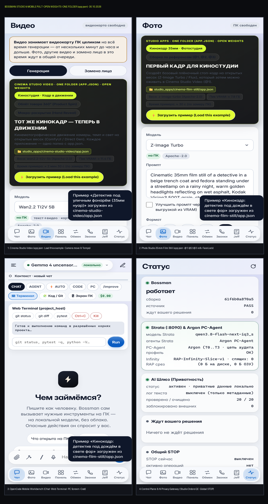

# AI MAX Bossman

**Bossman — локальный AI-рабочий стол владельца.** Один backend, одна база задач и памяти, одни права и одна
кнопка STOP — а к ним несколько пультов: Command Center в браузере, мобильный пульт для iPhone, Telegram-пульт
и CLI. Модели, генерации и файлы живут на ПК владельца (AMD Ryzen AI Max+ 395, Radeon 8060S, 128 GB единой
памяти, Windows 11); облачные модели подключаются только как собеседники и только в пределах бюджета владельца.

> Главное правило проекта: **функция считается добавленной, только когда она доказана** — тесты с негативным
> контролем, живой прогон на ПК владельца через тот же путь, которым он пользуется, и квитанция в
> [`docs/audits/`](docs/audits/INDEX.md). Без квитанции — `NOT_PROVEN`, даже если код есть.

## Витрина интерфейса (Bossman Studio & Мобильный пульт, 30.10.2026)



Студия открытых моделей по образцу Freefield / Higgsfield: каждое студийное приложение — одна папка с [`app.json`](apps/bossman-mobile/bossmobile/studio_apps/cinema-studio-video/app.json), открытые веса (`wan2.2-ti2v-5b`, `z-image-turbo`, `qwen-image-edit-2511`), выбор движения камеры (`Dolly in`, `Pan left`, `Orbit 360°`, `Tracking`, `Static 35mm`) и темпа (`Single shot`, `Slow burn`, `Dynamic cut`), кнопка **«⚡ Загрузить пример (Load this example)»** с заполнением проверенного лабораторного сценария и честными метриками пикового VRAM и времени (`measured` / `estimate`).

Отдельные экраны: [Cinema Studio Video](docs/media/ux-2026-10-30/01_cinema_studio_video_freefield.png) · [Фотостудия Freefield](docs/media/ux-2026-10-30/02_photo_studio_freefield.png) · [Чат и Агент OpenCode](docs/media/ux-2026-10-30/03_mobile_chat_opencode.png) · [Статус, AI Gateway и Заказы](docs/media/ux-2026-10-30/04_mobile_status_gateway_studio.png) · [Command Center `:8801`](docs/media/ux-2026-10-30/05_command_center_desktop_8801.png) · [Полный аудит 30.10](docs/audits/2026-10-30-full-project-audit-and-ux/REPORT_RU.md).

## Что умеет (срез 31.10.2026)

Статусы: **PROVEN** — живая квитанция с вердиктом PASS; **BETA** — способность доказана на синтетике или
эмуляторе, реального клиента/денег ещё не было; **OFF** — выключено решением владельца.

| Возможность | Статус | Квитанция |
|---|---|---|
| **BossBlock — 3D Мир для Игр (`apps/bossblock`, Aleph Game-Dev 5-Layer Capture)**: скачивание реальных городских кварталов для геймдева (Blender / UE5 / Unity / Godot) сразу в 5 слоях (3D-фотограмметрия `mesh.glb`, ортофото `satellite.png`/`tif` zoom 18, 3D-здания и дороги OSM `osm_buildings_roads.geojson`, рельеф `terrain.tif`, панорамы фасадов `Street View` + 4-панельный `bossblock_showcase.png`), карточка в мобильном пульте `:8840`, 3D-дашборд `:8845` и реальный захват центра г. Днепр, Украина (`236×222 м`, `67` зданий, `96` дорог, `40` узлов `mesh.glb` 188 КБ, `52` фото фасадов) | PROVEN | [2026-10-31-bossblock-dnipro-gamedev](docs/audits/2026-10-31-bossblock-dnipro-gamedev/receipt.json), [REPORT_RU.md](docs/audits/2026-10-31-bossblock-dnipro-gamedev/REPORT_RU.md) |
| Закрытие багов `main` по ТЗ `B1–B4` без новых функций: защитный гейт `ungrounded_screen_claim` (дефект `D-036`, `32/32` holdout и `130/130` всех 5 `tree_holdout`), обнаружение `uvicorn`/`:8801` и `:8840` в `owner_one_bossman.py find/status`, перепривязка устаревших облачных моделей и очистка зависших `waiting_approval` в `bcc.db` | PROVEN | [2026-10-31-main-bugfix-pass](docs/audits/2026-10-31-main-bugfix-pass/receipt.json), [REPORT_RU.md](docs/audits/2026-10-31-main-bugfix-pass/REPORT_RU.md) |
| Закрытие 4 дыр безопасности аудита (`1a–1d`: `pytest`/`git grep -O` → `WRITE`, исключение `git push`/`pip install` из временных аренд `PRIVILEGED`, очистка секретов и безопасная HTML-обрезка в `pult.report`, per-IP лимитер в `:8840`), режим **«Авто полный»** с карточкой владельца, автостарт с `main`, сверка цены 4-ходового диалога Outrun (`-$0.000009`) и Long-Horizon прогон `lh-20261031-autofull-v2` с подъёмом фактов из памяти (`P-07`, `C-0042`, `Север`) и отчётом 3/3 | PROVEN | [2026-10-31-security-autofull-long-horizon](docs/audits/2026-10-31-security-autofull-long-horizon/receipt.json), [REPORT_RU.md](docs/audits/2026-10-31-security-autofull-long-horizon/REPORT_RU.md) |
| Каталог студийных приложений Freefield-стиля (`app.json` в одной папке на приложение, открытые модели, `Load this example`, выбор движения камеры и темпа, честный `Peak VRAM` / время, отправка в пульт) | PROVEN | [2026-10-30-full-project-audit-and-ux](docs/audits/2026-10-30-full-project-audit-and-ux/receipt.json), [REPORT_RU.md](docs/audits/2026-10-30-full-project-audit-and-ux/REPORT_RU.md), [ux_verification_receipt](docs/audits/2026-10-30-full-project-audit-and-ux/ux_verification_receipt.json) |
| Локальный AI Privacy Gateway: классификация чувствительности (`PUBLIC` / `INTERNAL` / `CONFIDENTIAL`), локальная очистка ключей/паролей/seed-фраз/PII/счетов с заменой на `[КЛИЕНТ_1]`, минимальный пакет контекста, запрет прямых вызовов провайдеров и блок транзакций `EIP-7702 (type 0x04)` в терминале | PROVEN | [2026-10-29-ai-gateway](docs/audits/2026-10-29-ai-gateway/receipt.json), [README_RU.md](docs/audits/2026-10-29-ai-gateway/README_RU.md) |
| Сквозная сходимость контуров T1–T5 (T1/T2 Studio, T3 Governor, полная проверка всех кнопок и 8 вкладок мобильного пульта `:8840` в эмуляторе, T5 Swarm) | PROVEN (D-036 остаётся `NOT_PROVEN`) | [T1/T2 Studio](docs/audits/2026-10-29-studio-t1-t2/receipt.json), [T2 Live](docs/audits/2026-10-29-studio-t2-live-acceptance/receipt.json), [T3 Governor](docs/audits/2026-10-29-t3-governor/receipt.json), [T4 Mobile Emulator](docs/audits/2026-10-29-full-emulator-buttons-proof/receipt.json), [T5 Swarm](docs/audits/2026-10-29-t5-swarm/receipt.json) |
| Long-Horizon оркестратор 15 веток дерева Bossman в жёстком бюджете ≤\$1.00 с записью критических ошибок и правил восстановления в память Bossman | PROVEN | [2026-10-29-north-star-long-horizon-claude](docs/audits/2026-10-29-north-star-long-horizon-claude/receipt.json), [2026-10-30-long-horizon-run-g](docs/audits/2026-10-30-long-horizon-run-g/truth.json) |
| Защитные гейты по исследованиям недели (AgentProofBench `v2/verification.py`, CUA-Recovery `v2/recovery.py`, TimlMemBench `v2/memory/facts.py`, минимизация контекста): 23 юнит-гейта (`PASS_UNIT`) + живой агентный прогон через `/api/tasks` (`PASS_LIVE`, `task_id=816`) | PROVEN (`PASS_UNIT` + `PASS_LIVE`) | [2026-10-30-weekly-research-benchmarks](docs/audits/2026-10-30-weekly-research-benchmarks/receipt.json) |
| Локальный агент-оператор ПК (Argon PC-Agent P0–P5): уровни автономии `L0`–`L3`, файлы с корзиной, процессы/службы, песочница Shell, окна и UI Automation без ловушки `Alt`, `/browser`, отправка в пульт (≤10 файлов / ≤40 МБ), безопасный контур самоизменения с откатом и 5-минутным health-guard | PROVEN | [2026-10-26-argon-pc-agent-master](docs/audits/2026-10-26-argon-pc-agent-master/receipt.json), [REPORT_RU.md](docs/audits/2026-10-26-argon-pc-agent-master/REPORT_RU.md) |
| Самоправка кода Bossman через режим `AGENT` в мобильном пульте (`code.read`, `code.write`, `code.patch`, закрыты все 6 дефектов пульта/агента) | PROVEN | [2026-10-25-pult-agent-self-edit](docs/audits/2026-10-25-pult-agent-self-edit/receipt.json), [2026-10-26-argon-pc-agent-master](docs/audits/2026-10-26-argon-pc-agent-master/receipt.json) |
| Чат с локальной моделью: контекст между ходами, вложения (png, скан/текстовый pdf, docx, xlsx, pptx) доходят до модели как содержимое через локальное зрение | PROVEN | [2026-10-23-chat-attachments](docs/audits/2026-10-23-chat-attachments/README.md), [2026-10-24-functions](docs/audits/2026-10-24-functions/summary.json) |
| Правка фото из чата (`photo.edit` → локальная очередь Direct Gen, тот же STOP/история) | PROVEN | [2026-10-23-chat-attachments](docs/audits/2026-10-23-chat-attachments/README.md) |
| Локальная генерация изображений (sd-cli на Vulkan), очередь, провенанс и sha256 результата | PROVEN | [2026-10-24-functions](docs/audits/2026-10-24-functions/summary.json), [2026-10-24-direct-gen-freeze](docs/audits/2026-10-24-direct-gen-freeze/receipt.json) |
| Память: заметка-урок находится поиском и применяется в новой задаче; секреты хранятся только как `[REDACTED]` | PROVEN | [2026-10-24-functions](docs/audits/2026-10-24-functions/summary.json) |
| Облачные модели — только чат, без доступа к ПК (проверено живым негативом) | PROVEN | [2026-10-24-cloud-no-pc](docs/audits/2026-10-24-cloud-no-pc/receipt.json) |
| GLM 5.3 Flash через 7API: подключение, цена, лимит $5 | PROVEN | [2026-10-24-7api-glm](docs/audits/2026-10-24-7api-glm/receipt.json) |
| Ревью прав доступа внешней моделью → 3 исправления с тестами | PROVEN | [2026-10-24-glm-security](docs/audits/2026-10-24-glm-security/receipt.json) |
| Модели на новом SSD D: — холодная загрузка быстрее в 1.28–2.47×, «тёплые» прогоны без выигрыша | PROVEN | [2026-10-24-ssd](docs/audits/2026-10-24-ssd/verdict.json) |
| Голосовой ответ: медианная задержка 8.7–11.2 с → 4.8 с | PROVEN (измерено) | [2026-10-24-voice](docs/audits/2026-10-24-voice/receipt.json) |
| Две линии защиты ПК + матрица доказательств инструментов и навыков | PROVEN | [2026-10-22-pc-defense](docs/audits/2026-10-22-pc-defense/AUDIT_RU.md), [2026-10-22-tools-skills-proof](docs/audits/2026-10-22-tools-skills-proof/PROOF_MATRIX_RU.md), [2026-10-26-argon-pc-agent-master](docs/audits/2026-10-26-argon-pc-agent-master/receipt.json) |
| Верхняя панель: ядро и необязательные адаптеры разделены — внешний провайдер без ключа больше не красит исправный локальный сервер в «сбой» (было «сбой», стало «ядро в норме 24/24») | PROVEN | [topbar_health_split_receipt](docs/audits/2026-10-28-live-proofs/topbar_health_split_receipt.json) |
| Музыка: ACE-Step запускается по требованию под арендой памяти (старт 174 с, −9.6 LUFS, темп 130 измерен, а не угадан) | PROVEN | [music_ondemand_receipt](docs/audits/2026-10-28-live-proofs/music_ondemand_receipt.json) |
| Мобильный пульт: голос «удерживай микрофон» (MediaRecorder → ffmpeg → локальный Whisper → текст). Проверено в настоящем Chrome с тестовым микрофоном, на iPhone пока нет | PROVEN (Chrome) | [push_to_talk_receipt](docs/audits/2026-10-28-live-proofs/push_to_talk_receipt.json) |
| Инструмент `browser.active_tab_info`: настоящие адрес и заголовок активной вкладки Chrome, только чтение, только loopback | PROVEN | [browser_active_tab_info_receipt](docs/audits/2026-10-28-live-proofs/browser_active_tab_info_receipt.json) |
| Защита Windows: дерево процессов команды убивается Job Object-ом (терминал и `pc.run_command`), PowerShell разбирается по синтаксическому дереву, пути к секретам канонизируются, журнал `audit.jsonl` защищён от 20 из 20 способов тронуть его. Часть блоков ещё не подключена везде | BETA | [FREEZE_AUDIT_FINDINGS_RU](docs/audits/2026-10-28-live-proofs/FREEZE_AUDIT_FINDINGS_RU.md) |
| Честные статусы: найдены и убраны выдуманные артефакты (Video Studio 2.0 «7 из 7» на деле 0 из 7, не подключено), мобильный пульт без фасадов, фильтр «бесплатных» моделей больше не обходится | PROVEN | [FREEZE_AUDIT_FINDINGS_RU](docs/audits/2026-10-28-live-proofs/FREEZE_AUDIT_FINDINGS_RU.md) |
| Самоправка по настоящему дефекту (D-036): дефект воспроизведён на `main`, локальные воркеры патча не дали | NOT_PROVEN | [2026-10-28-self-repair-d036](docs/audits/2026-10-28-self-repair-d036) |
| Надстройка Bossman 2.0 (`/api/v20/*`), Obsidian Memory 2.0 (`68` заметок, `0` мусорных черновиков) и сведение Роя №2 (проверка квитанции одобрения `self-modify`, привязка токена `SpendFirewall` к `provider`/`model`, PowerShell `T3`-гейт, отзыв синтетического QLoRA-турнира) | PROVEN (код + тесты + живой `:8801`) | [01_SYNTHESIS_SWARM_RU](docs/audits/2026-10-28-swarm2-synthesis/01_SYNTHESIS_SWARM_RU.md), [09_MERGE_CHECKLIST_RU](docs/audits/2026-10-28-swarm2-synthesis/09_MERGE_CHECKLIST_RU.md) |
| Заработок B: заказы фотостудии — цена, себестоимость по реальным секундам генерации, маржа | BETA, выручка NOT_RUN | [2026-10-24-earn-studio-orders](docs/audits/2026-10-24-earn-studio-orders/receipt.json) |
| Заработок A: платный помощник по документам, счёт на банковский перевод | BETA, выручка NOT_RUN | [2026-10-24-earn-paid-docs](docs/audits/2026-10-24-earn-paid-docs/receipt.json) |
| Заработок C: досье по тендеру из открытых данных (офлайн) | BETA, выручка NOT_RUN | [2026-10-24-earn-tender-dossier](docs/audits/2026-10-24-earn-tender-dossier/receipt.json) |
| Заработок D: аудит сайта (стоматологии) с уликами на каждую находку, без рассылки | BETA, выручка NOT_RUN | [2026-10-24-earn-site-audit](docs/audits/2026-10-24-earn-site-audit/receipt.json) |
| Решение спорных вопросов голосованием трёх моделей (`tools/three_model_audit.py`) | BETA | [2026-10-24-three-model-audit](docs/audits/2026-10-24-three-model-audit/trademark-gate.json) |
| War Terminal (`apps/war-terminal`, :8830) — открытые данные тендеров | BETA | — |
| Jeff (бот-участник в Telegram) | ON — включён владельцем 28.10; причина прежней паузы (непонятная рассылка) до конца не установлена | — |
| Аренда GPU (RunPod и аналоги) | OFF — запрещено | — |

Что **не** доказано: самоулучшение с переносом опыта (Tier 5), полный цикл самоправки (D-036), суточный/двухсуточный soak,
реальная выручка. Video Studio 2.0 не подключена к генератору; `SpendFirewall` включается по желанию владельца, а не
по умолчанию.
Список таких утверждений — [CLAIMS_NOT_PROVEN.md](CLAIMS_NOT_PROVEN.md) и
[KNOWN_LIMITATIONS.md](KNOWN_LIMITATIONS.md).

## Быстрый старт

**Владельцу (Windows-сборка).** Распаковать проверенный ZIP в отдельную папку и дважды нажать
`Start-Bossman.cmd`; самопроверка — `Evening-Test.cmd`, затем сценарии приёмки HW-01…HW-13 из
[OWNER_ACCEPTANCE.md](OWNER_ACCEPTANCE.md). Подробно — [INSTALL.md](INSTALL.md).

**Из исходников (рабочая копия).** Все компоненты поднимаются одним launcher-ом из одного дерева:

```powershell
python tools/owner_one_bossman.py launch backend --src . --home <папка-установки> --data-dir <папка-данных>
python tools/owner_one_bossman.py find --data-dir <папка-данных>
python tools/owner_one_bossman.py stop --data-dir <папка-данных>
```

Перед сменой живого кандидата перенаправьте на одно дерево все пять «якорей» (launcher, scheduled tasks,
`governor.json`, pip editables, корни терминала) — см. раздел «One runtime = one tree» в [AGENTS.md](AGENTS.md).
Проверка: `/health` → `build_sha`.

## Порты

| Порт | Сервис |
|---:|---|
| 8801 | Command Center — backend и веб-интерфейс |
| 8840 | Мобильный пульт (iPhone, веб) |
| 8830 | War Terminal |
| 11434 | Ollama (локальные LLM) |

## Архитектура

```text
 iPhone / браузер / Telegram-пульт / CLI
            │  (все пульты — к одному backend)
            ▼
 ┌──────────────────────── Command Center :8801 ────────────────────────┐
 │  задачи и очередь · права (ask / auto / deny) · STOP · квитанции     │
 │  память (single writer) · бюджеты · журнал действий                  │
 └───────┬──────────────────────┬──────────────────────┬────────────────┘
         ▼                      ▼                      ▼
  Агент-роутер            Direct Gen               Инструменты ПК
  ├─ локальные LLM        sd-cli / Vulkan          терминал, файлы, окна
  │  (Ollama :11434)      фото, правка, видео      (только локальные агенты
  └─ облако: только чат   очередь + провенанс       и с разрешения владельца)
         │
         ▼
  Независимая проверка результата → квитанция → docs/audits/<дата>-<тема>/
```

Подробнее: [ARCHITECTURE.md](ARCHITECTURE.md) и [docs/INDEX.md](docs/INDEX.md).

## Правила безопасности

- Ключи, vault и DPAPI никогда не попадают в git и не отправляются наружу.
- Личные чаты, данные и фото владельца не читаются; отладка — по id и статусам, тесты — на синтетике.
  Личные фото не покидают ПК.
- Облачные модели — только чат. Исключение: Kimi K3.1 Pro (агент 47) — доступ к ПК с одобрением владельца
  на каждую команду.
- Платные модели — только в лимитах владельца (GLM 5.3 Flash $2/день, Haiku $2/день, суб-ключ 7API $5);
  сначала локальное и бесплатное.
- Аренда GPU (RunPod) запрещена. Ничего не отправляется в пульт без запроса владельца.
- Слияние в `main` — только кнопкой владельца; STOP, права и конституция с пином не обходятся.

Полный свод — [AGENTS.md](AGENTS.md).

## Как функция становится PROVEN

1. Юнит-тесты, включая негативный контроль (тест, который падает на сломанном коде).
2. Живой прогон на ПК владельца через реальный путь (чат, пульт, API) на синтетических данных.
3. Квитанция JSON в `docs/audits/<дата>-<тема>/` с точным `runtime_sha`, вердиктом и тем, что **не** доказано.
4. Ссылка на квитанцию в merge-коммите. Статус в дереве возможностей меняется только инструментами
   (`tools/tree_registry_sync.py`, `tools/tree_apply_evidence.py`), не руками.

Все квитанции — [docs/audits/INDEX.md](docs/audits/INDEX.md).

## Проверки интегратора

Владельцу этот раздел не нужен. Команды выполняются инженером в рабочей копии; они не заменяют установленную
Windows-сборку, реальную модель и HW-01…HW-13.

```bash
python scripts/update_readme_scorecard.py --check
python -m pytest tests/test_readme_commands_are_real.py -q
python -m pytest tests/test_readme_scorecard.py -q
python -m pytest tests/test_owner_acceptance_ps1_contract.py -q
python tools/docs_link_check.py README.md AGENTS.md docs/INDEX.md
```

После согласованного push задать `TESTED_SHA` полным 40-символьным SHA, сохранить в `runs.json` все страницы
GitHub Actions для него и сверить реальные jobs, checkout/build SHA и байты архива:

```bash
python tools/exact_sha_certify.py --sha "$TESTED_SHA" --runs-json runs.json --output exact-sha-certification.json
```

Спорное решение без владельца (ночью вопросы не задаются) — голосованием трёх моделей:

```bash
python tools/three_model_audit.py --help
```

<details>
<summary>Live Scorecard — оценка прогресса, не сертификат текущего кандидата</summary>

Источник — `docs/benchmark/current-scorecard.json`; блок восстанавливается `scripts/update_readme_scorecard.py`.
Это инженерная оценка, а не release-сертификат: exact-SHA CI и установленная приёмка текущих байтов нужны отдельно.

<!-- BOSSMAN_LIVE_SCORECARD_START -->
| # | Ось системы | Оценка | Статус | Уверенность | Улики |
|---|---|---:|---|---|---|
| 1 | Execution Truth | 9.1/10 | VERIFIED | HIGH | Browser download B4 now persists and verifies real artifacts instead of returning false success; Approval restart matrix is durable and task-bound effects remain exactly-once across hard restart |
| 2 | Security | 9.0/10 | VERIFIED | HIGH | CU-APPROVAL no longer trusts a model-supplied semantic field as proof of approval; CU-VERIFY fails closed on unknown or mistyped expectations; approval and anti-replay boundaries remain enforced |
| 3 | Tooling / OS Integration | 8.6/10 | INTEGRATED | HIGH | Owner hardware live run exercised Computer Use on Windows with 12/12 checks including focus, Cyrillic typing, STOP/resume and coordinate fallback; Local MAIN/FAST models, Chromium, FFmpeg and browser download were exercised on the Ryzen AI Max+ 395 target system |
| 4 | Organization Layer | 7.6/10 | INTEGRATED | MEDIUM | Mission/task orchestration and durable task state remain integrated; Planner/worker/verifier owner scenario still needs the final installed 1.0-RC re-run |
| 5 | Fleet & Resources | 7.2/10 | INTEGRATED | MEDIUM | Lease/fence/resource controls remain in place and owner repair used explicit desktop/backend/GPU leases; Media workers are bounded child processes rather than permanently resident generation daemons |
| 6 | Memory / Context | 7.2/10 | INTEGRATED | MEDIUM | Controlled audit disproved a general memory-loss P1; unique memory writes and restart continuity passed; Coaching/frontier learning design is documented, but holdout transfer is not yet measured |
| 7 | Testing / CI | 8.6/10 | VERIFIED | MEDIUM | Repair pass added targeted regressions for B4, AP-ALL, TEL-001, Computer Use safety, media hashing/cancel and UX settle; Full-suite triage found no confirmed product regression after harness/environment fixes; current exact-SHA mandatory CI is still pending |
| 8 | Observability / CEO Control | 7.9/10 | INTEGRATED | HIGH | Flight Recorder and installed-product telemetry were live on owner hardware; TEL-001 now reports model generation throughput from native/upstream timing rather than short-prompt wall time |
| 9 | Treasury / Cost | 6.9/10 | IMPLEMENTED | MEDIUM | Budget/cost gates remain fail-closed and unknown pricing is not treated as free; Frontier-audit/training and media cost-per-verified-result is not yet measured |
| 10 | Mission UX / Command Center | 7.8/10 | INTEGRATED | MEDIUM | Computer Use is wired into the owner product and real Windows interaction has owner evidence; F-17 page-settle race was fixed with a product-owned rendered-page signal |

- **Current bottleneck:** The repair pass is materially ahead of the 2026-09-07 scorecard, but the final repaired exact-SHA Windows artifact still needs mandatory CI, clean-install owner re-run, Video Studio product-path acceptance, coaching/holdout and an independent red-team.
- **Next highest-value fix:** Finish mandatory exact-SHA CI, build one clean Windows 1.0-RC artifact, then run the full owner acceptance and independent red-team on those exact bytes.
- **Last evidence SHA:** `0c1cbe651f5271bbd0bb2d30b467c1206c19f565` · **Current HEAD SHA:** `9e3aa192f513` · **Evidence freshness:** PARTIALLY_STALE
- **Last scorecard update:** 2026-09-22
- **Benchmark hard failures:** none observed
- **Live hardware attestation:** PENDING
- **Exact-SHA CI:** PASS

_Среднее (вторично, не авторитетно): 8.0/10. 10.0 = ATTESTED; ни одна ось не ATTESTED без живой аттестации железа._
<!-- BOSSMAN_LIVE_SCORECARD_END -->

</details>

## Документация

- [docs/INDEX.md](docs/INDEX.md) — карта документации.
- [docs/audits/INDEX.md](docs/audits/INDEX.md) — все квитанции.
- [AGENTS.md](AGENTS.md) — обязательные правила для AI-участников.
- [docs/archive/](docs/archive/INDEX_RU.md) — история: старые README, handoff-ы и планы (байты сохранены). Прежний
  полный README — [docs/archive/root-history/README_full_20261024.md](docs/archive/root-history/README_full_20261024.md).

## License

Код Bossman — [AGPL-3.0-only](LICENSE). Условия сторонних компонентов и моделей — [LICENSING.md](LICENSING.md).
