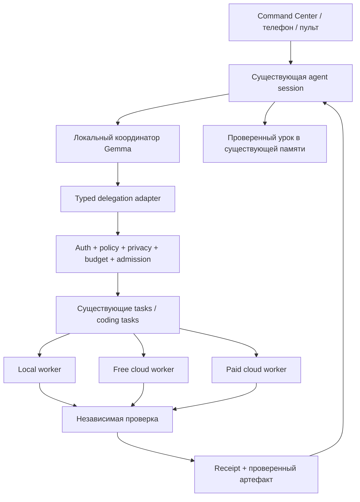

# Архитектурное решение: делегирование внутри одного Bossman

Статус: PROPOSED, автор Кодекс, 22.10.2026. Реализацию ведёт Аргон. Действующие контракты и gates из AGENTS.md сохраняют приоритет; сначала перечитать source map на актуальном SHA.

## Один контур исполнения

Использовать уже существующие auth, DB, tasks, coding workers, ToolSpec, event delivery, resource governor, model router и memory. Новый delegation adapter соединяет эти части. Он не вводит отдельную очередь, хранилище задач или второй orchestration backend. Если нужный метод уже существует в текущей работе Аргона, расширить его вместо параллельного implementation.

`cloud.ask` — консультация с внешней моделью; её ответ не означает исполнение агента. Полноценный помощник имеет child task, lifecycle, scoped capabilities, timeout, cancel, verifier и receipt. В начальном облачном варианте помощник возвращает предложение/артефакт; локальные инструменты запускаются только существующим серверным dispatcher после проверки политики.

## Три разные сущности

| Сущность | Смысл | Что сохранять |
|---|---|---|
| Agent definition | Роль, инструкция, разрешённые инструменты, маршрут модели | Existing agent ID, версия профиля, allowlist, лимиты |
| Worker/model | Конкретный локальный или облачный исполнитель | Точный provider/model ID, transport, capabilities, price revision |
| Agent run | Одно выполнение поручения | Existing task ID, parent/root IDs, frozen profile и route, события, receipt |

Нажатие «Создать агента» создаёт черновик определения. Генерация описания — отдельная задача с лимитом; она не устанавливает код, не выдаёт права, не запускает MCP и не создаёт аккаунты. Готовый черновик проходит schema/security review, затем явное включение владельцем.

## Предлагаемый typed tool

Предложение названия `agent.delegate`, а не описание уже работающего ToolSpec. Перед добавлением проверить актуальный REGISTRY.

[Предлагаемая JSON Schema](delegation-request.schema.json) отделяет пользовательский запрос от server-derived полномочий. Поле cost cap передаётся десятичной строкой для точного Decimal; ноль не даёт права на внешнюю передачу. Потолки схемы не отменяют более строгий effective policy. При подключении согласовать имеющиеся типы и migration, не ломать старых клиентов.

Вход: `agent_id`, ограниченный brief, `input_refs` на разрешённые очищенные артефакты, `expected_output`, проверяемые `acceptance_criteria`, `deadline_seconds`, запрошенный route и cap. Существующий client operation key приходит из исходного намерения и сохраняется при повторе.

Сервер сам назначает root/parent/child IDs и authenticated principal; модель не может выбрать чужую session, подделать owner или повысить scope. После авторизации сервер формирует immutable execution snapshot: профиль/его версия, модель/провайдер, инструменты/paths, content hash, price snapshot, budget reservation, policy revision и deadline. Все subsequent tool calls повторно проверяют действующие права и STOP.

Выход: существующий child task ID, `operation_id`, состояние, разрешённый event/receipt reference. `agent.status` и `agent.cancel` — возможные тонкие adapters существующих read/cancel APIs, только если их сейчас нет. Ожидание bounded; не удерживать HTTP запрос до бесконечного завершения.

## Жизненный цикл и результат

Это смысловые состояния UI, которые нужно отображать из существующих статусов, а не вводить вторую несовместимую state machine:

`DRAFT → PREFLIGHT → WAITING_APPROVAL → QUEUED → RUNNING → VERIFYING → SUCCEEDED`.

Ветки: `BLOCKED`, `FAILED`, `CANCEL_REQUESTED → CANCELLED`, `UNKNOWN_OUTCOME`. Успешный ответ провайдера ещё не SUCCEEDED: должны пройти acceptance criteria. Конечный статус и receipt сохраняются атомарно с existing task revision.

STOP из HTTP, WebSocket, mobile и UI вызывает один канонический cancel path. Root STOP запрещает новые дочерние dispatches, останавливает локальные процессы/их потомков в пределах scope и сохраняет результаты отмены. После STOP-ACK нельзя начинать новые tools/provider requests. Уже ушедший удалённый inference может завершиться и тарифицироваться: «запрос отмены» не выдавать за подтверждённую остановку провайдера. Хранить отдельно local cancellation и remote outcome.

При restart восстановить durable task state, не перезапускать неизвестный внешний эффект. Event epoch/cursor допускает snapshot resync. Работоспособность зависит от включённого компьютера и сети; обещание 24/7 без отдельного исполнителя недопустимо.

## Декомпозиция и ограничения роя

Координатор сначала определяет итог и независимый способ его проверки. Дробит только независимые участки с чёткими границами. Writer один на общий артефакт; аудиторы читают фиксированный SHA. Для действительно независимых edits — отдельные workspaces и один интегратор.

Временный стартовый профиль для измерения, не глобальная новая настройка: максимум 2 одновременно исполняющихся read-only помощника и depth=1. Recursive delegation запрещена, пока отдельным тестом не доказаны parent budget, cancellation и cycle detection. Resource Governor может уменьшить параллельность до одного. Если latency/стоимость хуже одиночного агента при том же качестве, делегирование отклонить.

Зависимые задачи запускаются только после VERIFIED предусловий. Здесь VERIFIED означает независимо проверенное постусловие existing task, а не новый буквальный task status или обязательный promotion в LessonBook. Сортировка DAG и нарисованная стрелка не доказывают runtime dependency enforcement. Ошибка зависимости → BLOCKED descendant, а не продолжение по свободному слоту.

## Каталог и стоимость

Использовать существующий model/worker catalog. Секции: LOCAL, FREE_CLOUD, PAID_CLOUD, UNAVAILABLE. Не закреплять в UI постоянно актуальный список имён или цен.

FREE_CLOUD допустим только при подтверждённых нулевых ценах всех применимых компонентов запроса и подходящих quota/route условиях. `:free`, отсутствие ключа и отсутствие receipt не являются достаточным финансовым доказательством. Неизвестная цена → N/A/BLOCKED для автоматического платного выбора. Бесплатное облако остаётся экспортом данных.

Preflight получает цену с датой/provider/model/units; учитывает input, output/reasoning, request/tool/media charges, если применимо, с provider-specific ceiling. Если верхнюю границу определить нельзя, не dispatch платного run.

Все paid paths, включая coding sidecars, должны пройти общий reserve/settle. Atomic reservation и операция claimed до отправки; сумма spent + reserved не превышает root owner cap. Последовательные и параллельные retries расходуют тот же общий budget. При timeout не освобождать reservation до reconciliation. После receipt списать фактическую стоимость, вернуть только доказанный остаток; неизвестную стоимость показать как reserved/UNKNOWN.

Approval связывается с exact sanitized payload/hash, route, caps и сроком. Изменение данных/модели/провайдера/cap требует нового preflight/approval; нельзя делать silent paid fallback. Валидный текущий owner grant можно использовать в его точных пределах, не спрашивая владельца снова без причины. Ключи остаются в vault; подписки CLI не трактуются как бесплатный API-кредит.

## Идемпотентность и внешние ответы

Один intent = один stable operation key. Его atomic unique claim действует до task creation и первого provider call. Повтор с тем же payload возвращает тот же task/result, другой payload под тем же ключом → conflict. In-flight duplicate получает pending; unknown outcome → status/reconciliation, не повторный dispatch. Не обещать exactly-once там, где провайдер не даёт operation lookup/idempotency: неизвестность должна оставаться видимой.

Ответы модели/агента, страницы и память считаются внешними данными. Они не меняют policy и не авторизуют tool сами по себе. Проверка действий остаётся на сервере; allowlist, scoped tokens и разрешённые paths проверяются перед каждым эффектом. API/receipt не раскрывают ключи, полный prompt, личные чаты или raw private paths. В UI вывод модели экранируется.

## Связь с 15 направлениями

Это роли поверх одной системы, а не 15 обязательных фоновых агентов:

| Направление | Пример ограниченного задания | Проверяемый итог |
|---|---|---|
| Jeff | Черновик ответа без отправки | Policy + source check |
| UX | Разбор synthetic экрана | Конкретный воспроизводимый дефект |
| Apps | Описание existing app capability | Сверка с API/исходником |
| Models | Выбор совместимого маршрута | Schema/capability check |
| Cloud | Предложение дешёвого помощника | Price/privacy/approval receipt |
| Computer | Read-only наблюдение тестового окна | Независимое наблюдение; STOP |
| Media | План нейтрального ролика | Проверка спецификации; генерация отдельно |
| Memory | Поиск применимого урока | Источник, версия и применимость |
| Agents | Декомпозиция и независимый review | Child tasks + verified result |
| Skills | Черновик recipe в candidate | Tests/review до promotion |
| Plugins | Проверка pinned manifest | License/scopes/compatibility |
| Ops | Разбор очищенного health snapshot | Source/runtime identity |
| OSS | Сравнение кандидатов | Pinned source + измеримый критерий |
| Commerce | Synthetic SwapMe quote | Decimal, явная ставка менеджера, без сделки |
| Devices | Отображение того же task на телефоне | Те же IDs, reconnect, canonical STOP |

## Проверенные внешние источники

Просмотрены 22.10.2026; это документация протокола, не подключённые модели Bossman:

- [OpenRouter model catalog](https://openrouter.ai/docs/api/api-reference/models/list-all-models-and-their-properties): метаданные моделей и pricing; сверять актуальную единицу каждого поля.
- [OpenRouter free variant](https://openrouter.ai/docs/guides/routing/model-variants/free): free-маршруты имеют собственные условия; не обещать постоянную доступность.
- [OpenRouter tool calling](https://openrouter.ai/docs/guides/features/tool-calling): модель предлагает вызов, клиент исполняет инструмент. Это поддерживает проверку и исполнение внутри Bossman.

Не добавлять новый agent framework только ради этого этапа. Upstream API и настоящая интеграция доказываются отдельно.
