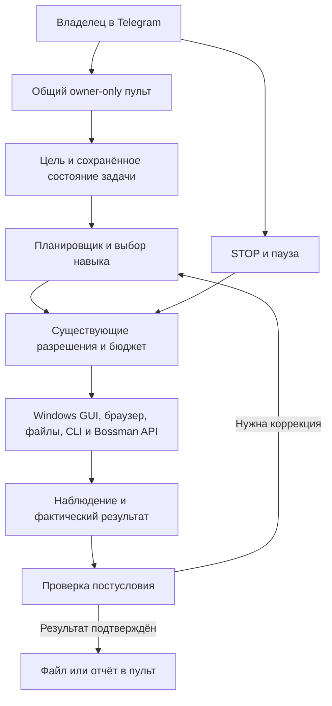

# Агентная архитектура Bossman 2.2

## Поручение владельца — временное замещение на время прогона (14.10.2026)

Argon на время текущего прогона замещает владельца в оперативном ведении уже
порученной работы и является основным интегратором Bossman. Прямые поручения
владельца определяют приоритет; исторические планы уступают актуальному заданию.
В пределах полученного разрешения Argon самостоятельно выбирает порядок действий,
исправляет дефекты, выполняет проверки, готовит документацию, коммиты и кандидат
сборки, без повторного запроса уже предоставленного разрешения. Эта правка
документации явно поручена владельцем отдельно от продуктовой реализации Argon.

Замещение относится к исполнению задач, а не к личности или полномочиям человека:
Argon остаётся агентом и не вправе выдавать собственное решение за подтверждение
владельца. Личная кнопка владельца для release_main, подтверждения расходов и
внешних действий, защита секретов, действующая конституция и её пин, permissions,
STOP и обязательные проверки сохраняются. Не менять agent/human-маркеры и не
обходить gates ради замещения. Новое разрешение не выводится из этой формулировки.
При блокировке продолжать независимую разрешённую работу и фиксировать конкретный
блокер. Владелец может уточнить или отменить замещение в любой момент; оно
завершается с окончанием текущего прогона и не действует автоматически в следующих.

Решение владельца от 13.10.2026: собственный агент с широким доступом к Windows через
общий owner-only Telegram-пульт. Документ задаёт целевую архитектуру; описанные проверки
ещё не являются результатами приёмки. Source checkpoint: `main b046b3b3`, checkout `af92a0fd`.

## 1. Сценарий владельца

«Открой приложение, выполни работу, сохрани результат, пришли мне файл». Агент получает
цель, самостоятельно выбирает GUI/API/CLI, выполняет разрешённую работу и проверяет
постусловие. Для задачи управления интерфейсом нужны реальные наблюдения и действия
мышью/клавиатурой. Для обработки файла допустим существующий CLI/API. В отчёте указан
фактический способ выполнения. Одного текста модели «сделано» недостаточно.

Широкий доступ означает доступ к нужным приложениям, браузеру, пользовательским файлам,
управлению процессами и настройкам в пределах поручения. Владелец сохраняет STOP,
паузы и решения по чувствительным внешним действиям. Уже данное разрешение действует
в своей области: повторно спрашивать его для каждого безопасного подшага не нужно.

## 2. Один исполняемый контур

CLI, dashboard, Telegram, Jeff и Motion используют существующие backend, storage,
permissions, модели, jobs, память и evidence. Отдельный «Telegram brain», вторая база
памяти, второй poller того же токена или новая очередь вместо общей не нужны.
Модули могут иметь отдельные процессы, но сохраняют общую task identity и журнал.

## 3. Компоненты и существующие точки расширения

Пути ниже относительно корня репозитория. Это карта исходников на checkpoint, не PASS.

| Компонент | Существующий источник | Требуемая связка |
|---|---|---|
| Вход и доставка владельцу | `command-center/bcc/telegram_companion/service.py`, `config.py`, `adapters.py` | Проверка sender/chat, одна task identity, квитанция доставки |
| Управление из пульта | `command-center/bcc/telegram_companion/console.py`, `operator_bridge.py` | Общая задача, наблюдение, статус, STOP, approvals |
| Реальный рабочий стол | `command-center/bcc/features/tools_computer.py`, `bossman-core/bossman/computer_operator/` | Observe → act → новое observe; привязка окна HWND/PID |
| Команды и файлы | `command-center/bcc/features/tools_terminal.py`, `v2/terminal_control.py` | Разрешённые roots/argv, stdout/error, проверка созданного файла |
| Процессы и удалённый доступ | `command-center/bcc/telegram_companion/remote_access.py` | Проверенная identity процесса, безопасный restart/reboot |
| Оператор Qwen | `command-center/bcc/features/qwen_operator.py` | Переиспользовать план, попытки, лабораторию, approvals и receipts |
| Медиа | `command-center/bcc/telegram_companion/gen_refine.py`, `features/motion_workflow_api.py`, `studio/` | Общий каталог/очередь, выбор модели, артефакт и замер |
| Разрешения | `command-center/bcc/permissions.py`, `v2/permissions.py`, `autonomy/` | Одно решение AUTO/ASK/DENY для всех интерфейсов |
| Память, данные, evidence | Существующие storage/db и evidence-реестры из A22-05/08 | Durable state, происхождение уроков, неизменные квитанции |

На `main b046b3b3` оператор уже имеет read-only задачи, разрешённые host-команды
и allowlist части Motion/Studio API. Promotion endpoint оператора возвращает 403,
push/merge выполняются отдельным release-процессом. Нельзя писать, что это
лишь кодер без host-доступа. При этом API-allowlist Motion не равен общему GUI-агенту:
нужны маршрутизация естественной задачи в Computer Use и сквозные Windows-доказательства.

Различать две точки: `/promote` всегда отказывает, но отдельная owner decision
`release_main` и `apply_lab_push` в коде есть. Они проверяют ветку/commit/verifier и
защищённые файлы перед owner-approved push. По ночному checkpoint живое слияние
этим путём ещё не доказано. Отказ одного endpoint не означает отсутствия другого пути.

## 4. Роли моделей

| Роль | Контракт |
|---|---|
| Планировщик/исполнитель/диагност | Настроенная локальная Qwen с выбранным владельцем профилем |
| Наблюдение | Реальный screenshot/UIA и совместимая локальная vision-модель при необходимости |
| Промпт генерации | Отдельно выбранная локальная text-модель |
| Изображение/редактирование/видео | Три совместимых визуальных движка из общего каталога |
| Проверяющий | По возможности другое семейство; чистый контекст и отдельные входные доказательства |

Текстовая Qwen не заменяет diffusion/video engine. Для каждой роли фиксируются реальный
model ID, revision/hash, параметры, контекст и вызовы. Предпочтение uncensored задаёт
профиль поведения; права инструментов регулируются общей политикой. Другая сессия
той же модели имеет ограниченную независимость, это отражается в квитанции.
Наличие бесплатной облачной модели не разрешает передавать ей личные материалы.

Для применения/продвижения изменений действует конституция v2: зелёные применимые
тесты и одобрения минимум двух независимых проверяющих разных семейств, хотя бы один
внешний, автор не проверяет себя. Ограниченно независимый второй контекст не заменяет
этот gate. Конкретный release tier и решение владельца сохраняются.

256k — ранее заявленная цель, не фактическая настройка по умолчанию. В коде оператора
checkpoint есть адаптивный default 64k; исполнитель читает реальную конфигурацию и
возможности модели. Молчаливое обещание 256k или облачный fallback недопустимы.

## 5. Состояние и восстановление

Минимальные состояния: received → planned → running → verifying → delivered;
дополнительно waiting_owner, paused, stopped, failed и recovery_required.
Это контракт соответствия существующим state enums, не требование второй state machine.
Хранить task ID, owner ID, шаг, попытку, approvals, model snapshot, job/output IDs и
квитанцию доставки в существующем storage. Не сохранять секреты в обычные логи.

У каждого внешнего действия есть idempotency key и способ reconcile. После сбоя сначала
проверяется фактический результат, затем продолжается работа. Неизвестный исход отправки,
платежа или публикации не повторяется автоматически. STOP переживает перезапуск;
RESUME требует свежего наблюдения и проверки scope. Долгая генерация не занимает control-линию.
На одну ошибку — до трёх осмысленных попыток с диагностикой и откатом при ухудшении.
Общего искусственного дедлайна задачи нет; таймауты инструментов и лимиты ресурсов остаются.

## 6. Доступ и приватность

Вход и каждый эффект проверяют owner role, Telegram user/chat и разрешённый pc_control
scope. Callback другого пользователя/чата, пересланная кнопка и устаревшее разрешение
не дают прав. Разрешения читаются из принятой владельцем конституции и общей системы approvals.
Коммит `af92a0fd` фиксирует принятие v2; runtime проверяет актуальный pin/hash. Агент
не пишет пин и не меняет собственные gates. Уже разрешённая отправка конкретных файлов
владельцу допустима через существующий пульт; это не разрешение отправки другим людям.

Если шаг требует нового разрешения, пульт показывает точное действие, причину и кнопки
разрешения/отказа; независимые разрешённые шаги продолжаются. Credential extraction,
изменение политики, деньги, важное удаление, публичный выпуск и сообщения третьим лицам
подчиняются текущей области разрешений. Веб-страницы, документы и stdout — данные,
они не могут расширить права агента. Секреты не включаются в Git, скриншоты и отчёты.

## 7. Что принять прежде чем называть агент готовым

1. Задача из настоящего owner Telegram до файла на Windows и подтверждённой доставки.
2. Реальное наблюдение окна, действия мышью/клавиатурой и независимое постусловие.
3. STOP в середине, неверное/устаревшее окно, отказ неизвестному Telegram ID.
4. Падение/restart без потерь, дубликатов и самопроизвольного RESUME.
5. Read-only задача и разрешённая host/API задача; выбранный путь отражён в receipts.
6. Одна нейтральная генерация с MC22-16: фиксированная модель, файл, cold/warm время.
7. Рабочий путь с отключённым Claude/Codex fallback и списком реальных workers.
8. Headless/autostart после согласованного reboot с резервным доступом; наличие процесса
   без интерактивной Windows-сессии не считается работающим GUI.

Эти проверки относятся к A22-01..05/10/12 и MC22-01..05/16. Самоисправление и перенос
навыка имеют отдельные A22-06..09 gates. Полные критерии, выборки и лицензии сохраняются
в остальных спецификациях. Коммерческие пилоты Jeff/Motion/Operations/Reports, Poker,
музыка, Apps и дерево входят в того же Bossman; ни один старый ID не удаляется.
