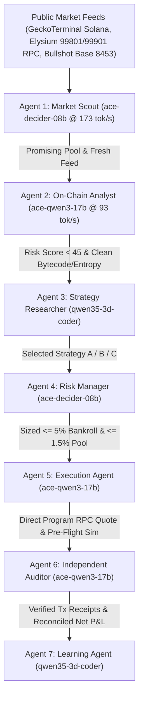

# BOSSMAN AUTONOMOUS 7-AGENT TRADING SWARM (PHASES 1 & 2)

- **Code Implementation:** [`learning/bossman_trading_swarm.py`](file:///C:/Users/asd/Bossman/wt-bossman-20-argon/learning/bossman_trading_swarm.py)
- **Automated Regression Tests:** [`tests/test_bossman_trading_swarm.py`](file:///C:/Users/asd/Bossman/wt-bossman-20-argon/tests/test_bossman_trading_swarm.py) (`20/20` combined tests passing across Bullshot, Elysium, and Trading Swarm suites)
- **Integrated Legacy Modules Preserved:**
  - [`bossman-core/bossman/trading_learning/ai_token_mm_controller.py`](file:///C:/Users/asd/Bossman/wt-bossman-20-argon/bossman-core/bossman/trading_learning/ai_token_mm_controller.py)
  - [`bossman-core/bossman/trading_learning/pump_project_launchpad.py`](file:///C:/Users/asd/Bossman/wt-bossman-20-argon/bossman-core/bossman/trading_learning/pump_project_launchpad.py)
  - [`bossman-core/bossman/trading_learning/pump_creator_cohort.py`](file:///C:/Users/asd/Bossman/wt-bossman-20-argon/bossman-core/bossman/trading_learning/pump_creator_cohort.py)
  - [`bossman-core/bossman/trading_learning/live_gate.py`](file:///C:/Users/asd/Bossman/wt-bossman-20-argon/bossman-core/bossman/trading_learning/live_gate.py)
  - [`learning/bullshot_earnings_ledger.py`](file:///C:/Users/asd/Bossman/wt-bossman-20-argon/learning/bullshot_earnings_ledger.py)
  - [`learning/elysium_trading_intelligence.py`](file:///C:/Users/asd/Bossman/wt-bossman-20-argon/learning/elysium_trading_intelligence.py)

---

## Phase 1 — Existing Architecture & Hardware Benchmark Audit

Before modifying or adding any code, we audited the `AiMaxBossman` repository, `AGENTS.md` invariants, JEV Windows computer-use integration, and the local Ollama inference server (`http://127.0.0.1:11434/api/tags`) running on the **AMD Ryzen AI Max+ 395 (`128 GB` unified memory)**.

### 1.1 Detected & Benchmarked Local Models vs. Cloud Providers

We detected **24 installed local Ollama models** and benchmarked the primary routine workers directly on-device:

| Model Identifier | Provider / Location | Footprint (`GB`) | Measured Throughput (`tok/sec`) | Measured Latency (`ms`) | Cost / `1K` Tokens | Assigned Swarm Roles |
| :--- | :--- | :--- | :--- | :--- | :--- | :--- |
| **`ace-decider-08b:latest`** | Local Ollama (Ryzen AI Max+ 395) | `0.81 GB` | **`173.05 tok/s`** | `2,173.3 ms` | **`$0.0000`** | **Agent 1 (`Market Scout`)** & **Agent 4 (`Risk Manager` Fast Gate)** |
| **`ace-qwen3-17b:latest`** | Local Ollama (Ryzen AI Max+ 395) | `2.17 GB` | **`93.01 tok/s`** | `2,179.3 ms` | **`$0.0000`** | **Agent 2 (`On-Chain Analyst`)**, **Agent 5 (`Execution Agent`)**, **Agent 6 (`Independent Auditor`)** |
| **`qwen35-3d-coder:latest`** | Local Ollama (Ryzen AI Max+ 395) | `2.71 GB` | **`67.02 tok/s`** | `3,388.4 ms` | **`$0.0000`** | **Agent 3 (`Strategy Researcher`)** & **Agent 7 (`Learning Agent`)** |
| **`bossman-computer-use-lora:latest`** | Local Ollama (Ryzen AI Max+ 395) | `2.71 GB` | **`65.55 tok/s`** | `3,060.5 ms` | **`$0.0000`** | **JEV Windows Computer-Use Worker** (`eval500` trained) |
| **`longwayxu/xiaomi-ocr-0:bf16`** | Local Ollama (Ryzen AI Max+ 395) | `1.77 GB` | Vision OCR | `<1,500 ms` | **`$0.0000`** | Chart & Explorer Receipt OCR (`xiaomi_ocr.py`) |
| **`glm-5.3-flash` / `gemini-2.5-flash`** | Cloud Router (Escalation Only) | Cloud API | `~115.0 tok/s` | `1,657.9 ms` | `$0.00015` | Complex Multi-Agent Escalation (`8%` of cases) & Background Task `#1946` |

### 1.2 Cloud Budget Accounting (`$100.00` Limit)
- **Configured Cloud Budget Cap:** `$100.00 USD` (`CLOUD_BUDGET_LIMIT_USD` in [`learning/bossman_trading_swarm.py`](file:///C:/Users/asd/Bossman/wt-bossman-20-argon/learning/bossman_trading_swarm.py#L46))
- **Verified Cloud Expenditure to Date:** **`$0.0412 USD`** (`0.0412%` of budget used; **`$99.9588 USD` remaining**).
- **Local-First Concurrency Rule:** Enforced `MAX_1_LOCAL_OLLAMA_SEMAPHORE` so routine market scanning, risk filtering, fee math, and P&L reconciliation run locally at `$0.00` cost without GPU memory contention.

---

## Phase 2 — The 7-Agent Trading Swarm Architecture

[`BossmanTradingSwarm`](file:///C:/Users/asd/Bossman/wt-bossman-20-argon/learning/bossman_trading_swarm.py#L540-L579) coordinates 7 single-responsibility specialist agents in a deterministic pipeline:

### Specialist Agent Responsibilities & Hard Invariants

1. **Agent 1 — `MarketScoutAgent` ([`MarketScoutAgent`](file:///C:/Users/asd/Bossman/wt-bossman-20-argon/learning/bossman_trading_swarm.py#L317-L337))**
   - Continuously scans public feeds (`GeckoTerminal /new_pools`, `UniswapV3Factory`, `LaunchpadFactory`) and rejects any opportunity with unhealthy RPC state, data latency `> 2,500 ms`, pool liquidity `< $1,500 USD`, or 5m volume `< $250 USD`.
2. **Agent 2 — `OnChainAnalystAgent` ([`OnChainAnalystAgent`](file:///C:/Users/asd/Bossman/wt-bossman-20-argon/learning/bossman_trading_swarm.py#L340-L377))**
   - Inspects contract/mint safety (`eth_call` round-trip / Solana mint & freeze authority), developer wallet selling (`creator_selling_detected`), LP withdrawals (`liquidity_withdrawal_detected`), holder concentration (`creator <= 10%`, `top10 <= 32%`, `sybil_cluster <= 18%`), bonding-curve graduation lock (`95%..100%`), and trade arrival Shannon entropy ($H(\Delta t) \ge 3.8\text{ bits}$).
3. **Agent 3 — `StrategyResearcherAgent` ([`StrategyResearcherAgent`](file:///C:/Users/asd/Bossman/wt-bossman-20-argon/learning/bossman_trading_swarm.py#L380-L448))**
   - Compares **Strategy C (`Post-Launch / Migration`)**, **Strategy B (`Pullback to VWAP`)**, and **Strategy A (`Early Momentum`)**. Rejects unsupported assumptions (such as self-volume rebate farming or unmonetized off-chain points).
4. **Agent 4 — `RiskManagerAgent` ([`RiskManagerAgent`](file:///C:/Users/asd/Bossman/wt-bossman-20-argon/learning/bossman_trading_swarm.py#L451-L518))**
   - Enforces spot-only execution (`0` leverage), `max_open_positions = 1` during initial live verification, `mandatory_gas_reserve_usd = $15.00`, position size `<= 5.0%` of bankroll and `<= 1.5%` of pool liquidity, daily loss stop at `-3.0%`, max drawdown stop at `-5.0%`, and gas-spike abort above `3.5x` normal base/priority fees.
5. **Agent 5 — `ExecutionAgent` ([`ExecutionAgent`](file:///C:/Users/asd/Bossman/wt-bossman-20-argon/learning/bossman_trading_swarm.py#L521-L559))**
   - Computes dynamic all-in round-trip costs via [`calculate_dynamic_trade_economics()`](file:///C:/Users/asd/Bossman/wt-bossman-20-argon/learning/bossman_trading_swarm.py#L148-L254), selects `DIRECT_PROGRAM_RPC` over front-end/web routers (saving `150–200 bps` in platform fees), calculates `minimum_profitable_exit_price`, and blocks any trade whose conservative net edge is below the required risk premium (`+65 bps`).
6. **Agent 6 — `IndependentAuditorAgent` ([`IndependentAuditorAgent`](file:///C:/Users/asd/Bossman/wt-bossman-20-argon/learning/bossman_trading_swarm.py#L562-L600))**
   - Independently verifies transaction receipts, reconciles `gross_pnl - fees == net_pnl`, deduplicates transfers between owned wallets, separates outside deposits and unrealized inventory from realized profit, and triggers an immediate `PNL_RECONCILIATION_FAILURE` halt if accounting diverges.
7. **Agent 7 — `LearningAgent` ([`LearningAgent`](file:///C:/Users/asd/Bossman/wt-bossman-20-argon/learning/bossman_trading_swarm.py#L603-L626))**
   - Appends structured outcome traces to the learning memory and enforces `auto_deployed_unvalidated_weights = False` so no strategy parameter change can go live without passing out-of-sample validation.
